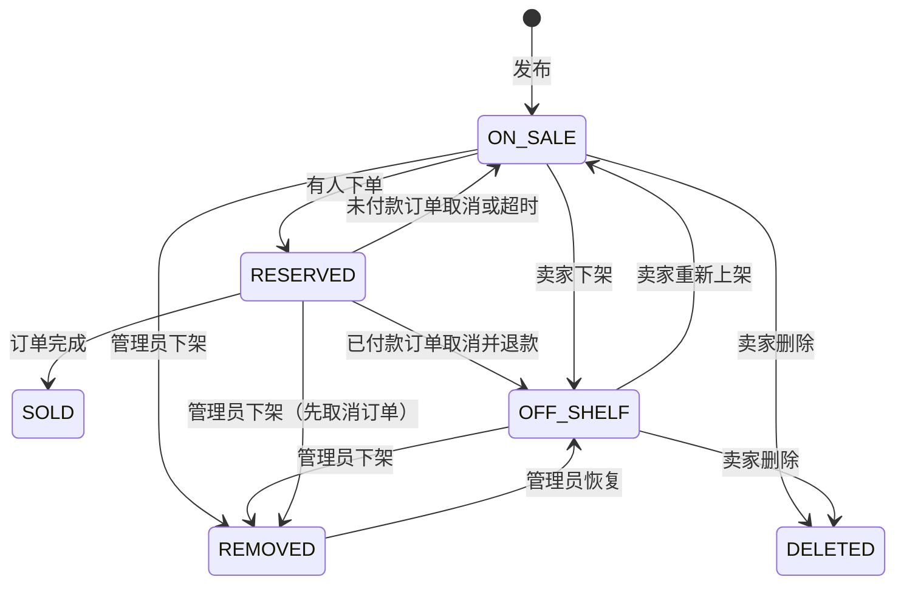
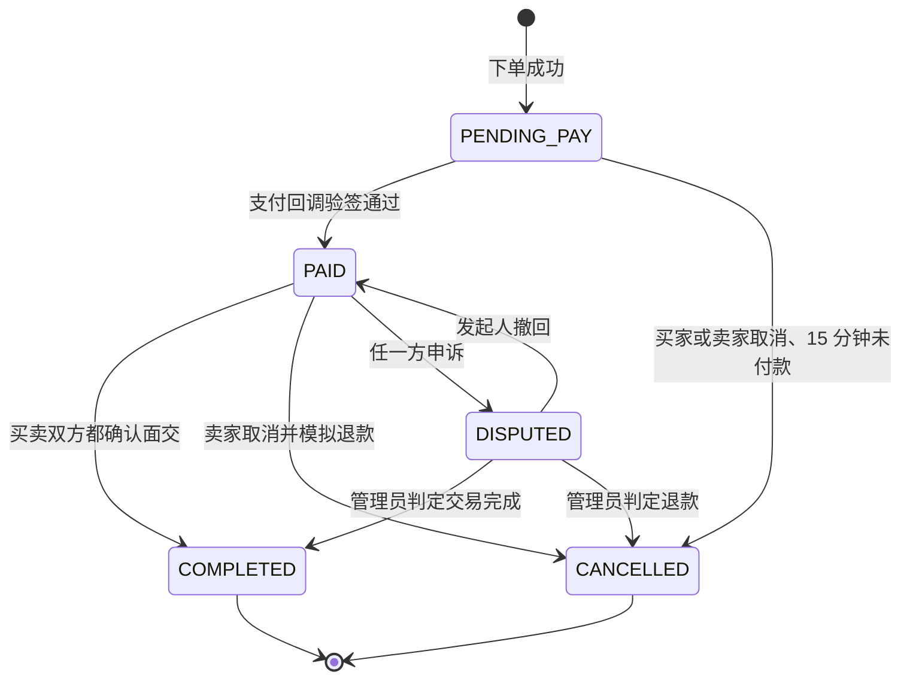
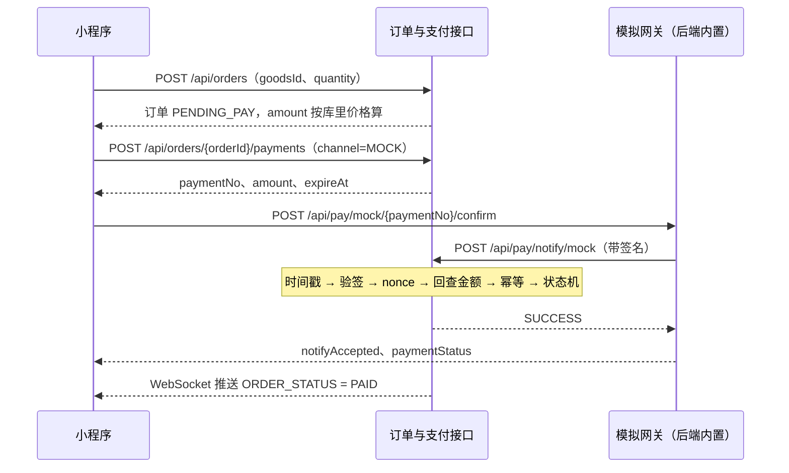

# 校园二手交易平台 · Base API 接口文档


| 项    | 内容                                                             |
| ---- | -------------------------------------------------------------- |
| 版本   | v0.1 设计稿（2026-09-29）                                           |
| 适用   | 项目 A（AI 议价）、项目 B（成色与仲裁）分叉之前的公共底座                               |
| 技术栈  | Spring Boot 3.4 / Java 17、MySQL 8、Redis、uni-app（Vue 3）编译为微信小程序 |
| 实现状态 | 仓库目前只有 `GET /api/health`，其余接口都是待实现的契约                          |
| 维护   | 后端组长维护，前端组长审阅，改动走 PR                                           |


A、B 分叉后各写一份 `A-API.md`、`B-API.md`，只写新增的接口和字段。本文件里已有的路径、字段含义、错误码和状态机不改；确实要改，先回到 base 改这份文档，再同步两边。

代码实现后由 Knife4j（springdoc）导出 OpenAPI，再导入 Apifox。本文件、OpenAPI、Apifox 三处不一致时，先确认哪边对，改本文件，再改代码。

---

## 1. 范围

### 1.1 base 包含

- 微信登录；校园身份人工审核
- 个人资料、公开主页、交易评价
- 商品：发布、编辑（含改价）、上下架、删除、搜索筛选、按楼栋就近、详情、收藏、浏览记录
- 订单：下单不超卖、状态机、取消与超时、约定面交、双方确认面交、申诉入口
- 模拟支付：支付单、沙箱收银台、回调验签、防重放、回查金额、幂等、模拟退款
- 站内聊天：会话、文字和图片消息、联系方式屏蔽、WebSocket 推送
- 站内通知、举报
- 管理端：认证审核、封禁、商品下架与恢复、订单查询、申诉简版处理、举报处理、审计日志、基础数据
- 安全审计日志（攻防演示用）

### 1.2 不在 base


| 内容                                                        | 去向                           |
| --------------------------------------------------------- | ---------------------------- |
| 大模型填表、建议价、议价话术、报价令牌                                       | 项目 A                         |
| 成色评估记录（自评清单、人工或模型评定）                                      | 项目 B                         |
| 仲裁（立案、举证、裁决）                                              | 项目 B；base 只提供「申诉中」状态和管理员简版处理 |
| 自然语言搜索、求购反向匹配、候补队列、组合发布、校园专题（毕业季、教材、赠送专区）、订阅消息全量、学校统一身份接口 | 计划书未排入进度                     |
| 免费赠送（价格为 0）                                               | 不做；价格最低 0.01 元，所有订单都走支付      |
| 真实支付、站内钱包、用户余额                                            | 不做                           |


### 1.3 与其他文档的关系

- `doc/ARCH.md` 的订单四态在这里补了 `DISPUTED`（申诉中），与项目计划书 WP6 一致。已付款后取消，订单同样是 `CANCELLED`，退款记在支付单上，不另设订单状态。
- 计划书里的中文状态名和本文件枚举的对应见 §10.1。

---

## 2. 环境与接入

### 2.1 环境


| 环境    | 用途           | HTTP 基址                 | WebSocket                   | Spring profile | 数据                                                  |
| ----- | ------------ | ----------------------- | --------------------------- | -------------- | --------------------------------------------------- |
| local | 个人开发         | `http://127.0.0.1:8080` | `ws://127.0.0.1:8080/ws/im` | `local`        | 本机库 `campus_ershou`；Redis 前缀 `campus:local:`        |
| test  | 联调、Apifox 回归 | `https://{测试域名}`        | `wss://{测试域名}/ws/im`        | `test`         | 服务器库 `campus_ershou_test`；前缀 `campus:test:`         |
| demo  | 原型评审、彩排、展示   | `https://{展示域名}`        | `wss://{展示域名}/ws/im`        | `demo`         | 服务器库 `campus_ershou_demo`；前缀 `campus:demo:`；展示前一周冻结 |


文中的 Redis 键都省略环境前缀，例如 `lock:goods:{goodsId}` 在 test 环境实际是 `campus:test:lock:goods:{goodsId}`。

### 2.2 各环境开关


| 开关                         | local | test   | demo   | 说明                            |
| -------------------------- | ----- | ------ | ------ | ----------------------------- |
| `POST /api/auth/dev-login` | 开     | 关（404） | 关（404） | 免微信登录，只给本机造多账号                |
| Knife4j / OpenAPI 页面       | 开     | 关      | 关      | 服务器上不暴露接口清单；Apifox 从 local 导出 |
| 模拟支付网关 `pay.mock.enabled`  | 开     | 开      | 开      | 课程全程用模拟支付                     |
| 错误响应带异常详情                  | 开     | 关      | 关      | 关掉后只返回错误码和 traceId            |


### 2.3 小程序端

- 地址写在 `frontend/src/config.js`：已有 `API_BASE`，需要新增 `WS_BASE`（本机为 `ws://127.0.0.1:8080`）。
- 开发者工具：详情 → 本地设置 → 勾选「不校验合法域名、web-view（业务域名）、TLS 版本以及 HTTPS 证书」，才能访问 `http://127.0.0.1`。
- 真机预览：手机访问不到 `127.0.0.1`，改成电脑的局域网 IP，或者直接用 test 环境域名。改过的地址不要提交。
- 体验版、正式版：在小程序后台「开发管理 → 开发设置 → 服务器域名」配置 request、socket、uploadFile、downloadFile 四类合法域名；必须是 HTTPS / WSS，域名要已备案。
- 小程序的 `wx.request` 不支持 `PATCH`，所以本文件的修改接口只用 `PUT` 和 `POST`。

### 2.4 服务器（和已有项目同机）

服务器上已有 MySQL、Redis、Nginx，课设不另装：

- MySQL：每个环境一个库（§2.1），各用独立账号，只授权本库。
- Redis：只监听 `127.0.0.1` 并设密码；课设的键都带 `campus:{env}:` 前缀，不和已有项目混用。
- Spring Boot：只监听 `127.0.0.1`，由 Nginx 对外。test、demo 各一个进程、各一个端口。

Nginx 示例（每个环境一份，端口换成对应进程的端口）：

```nginx
server {
    listen 443 ssl;
    server_name {展示域名};
    ssl_certificate     /etc/nginx/cert/{展示域名}.pem;
    ssl_certificate_key /etc/nginx/cert/{展示域名}.key;

    client_max_body_size 10m;

    location /api/ {
        proxy_pass http://127.0.0.1:8080;
        proxy_set_header Host $host;
        proxy_set_header X-Real-IP $remote_addr;
        proxy_set_header X-Forwarded-Proto $scheme;
    }

    location /ws/ {
        proxy_pass http://127.0.0.1:8080;
        proxy_http_version 1.1;
        proxy_set_header Upgrade $http_upgrade;
        proxy_set_header Connection "upgrade";
        proxy_set_header Host $host;
        proxy_set_header X-Real-IP $remote_addr;
        proxy_read_timeout 120s;
    }

    location /files/public/ {
        alias /data/campus-ershou/demo/uploads/public/;
        expires 7d;
    }
}
```

客户端 IP：后端只在请求来自 `127.0.0.1`（即 Nginx）时读取 `X-Real-IP`，其他情况用连接地址。客户自己带的 `X-Forwarded-For` 一律不用，否则按 IP 限流能被伪造请求头绕过。

### 2.5 本机配置项（不进仓库）

放在 `application-local.yml`，服务器上用对应环境的配置文件或环境变量。随机值用 `openssl rand -hex 32` 生成，每个环境各不相同。


| 配置                          | 用途                                   |
| --------------------------- | ------------------------------------ |
| `spring.datasource.*`       | 数据库地址、账号、密码                          |
| `spring.data.redis.*`       | Redis 地址、密码                          |
| `wx.app-id`、`wx.app-secret` | 调微信 `jscode2session`                 |
| `auth.jwt.secret`           | 签发 token，至少 32 字节随机                  |
| `auth.student-no.hmac-key`  | 学号 HMAC 摘要                           |
| `pay.mock.secret`           | 模拟网关回调签名                             |
| `pay.mock.notify-url`       | 模拟网关回调地址，默认本机 `/api/pay/notify/mock` |
| `file.root`、`file.sign-key` | 图片存储目录；私有图片临时地址的签名密钥                 |
| `admin.init-password`       | 第一个管理员的初始密码，首次登录后必须改                 |


---

## 3. 通用约定

### 3.1 请求

- 接口路径以 `/api` 开头；WebSocket 是 `/ws/im`；公开图片是 `/files/public/**`。
- 请求体用 JSON（`Content-Type: application/json; charset=utf-8`），上传用 `multipart/form-data`。
- 字段名用 camelCase。
- 查询参数的多个值用英文逗号分隔，例如 `status=PENDING_PAY,PAID`。查询参数多了不报错，直接忽略。

### 3.2 认证

- 登录后每个请求带请求头 `Authorization: Bearer <token>`。
- token 是 JWT，算法固定 HS256，服务端拒绝 `alg: none` 和其他算法。载荷：`sub`（用户 ID）、`typ`（`user` 或 `admin`）、`ver`（令牌版本）、`jti`、`iat`、`exp`。
- 有效期：用户 7 天，管理员 12 小时。用户 token 不能调管理端，管理员 token 也不能调用户接口。
- token 失效的情况：过期；登出（`jti` 进黑名单直到过期）；被封禁（令牌版本加一，已发出的全部失效）。
- 收到 401：小程序静默调 `uni.login` 重新走 §6.1，拿到新 token 后重发原请求，只重试一次（示例见 §18.1）。

### 3.3 响应包

除健康检查（§5.1）、私有图片本体（§8.3）、支付回调（§11.6）以外，所有接口都返回：

```json
{
  "code": "OK",
  "message": "ok",
  "data": {},
  "traceId": "8c1f0a2b9d3e4f57"
}
```

出错时：

```json
{
  "code": "GOODS_NOT_AVAILABLE",
  "message": "商品已被他人预约或已下架",
  "data": null,
  "traceId": "8c1f0a2b9d3e4f57"
}
```

字段校验失败时 `data` 带明细：

```json
{
  "code": "VALIDATION_FAILED",
  "message": "参数校验失败",
  "data": {
    "fieldErrors": [
      { "field": "title", "message": "标题 2–30 个字" },
      { "field": "imageFileIds", "message": "至少 1 张图片" }
    ]
  },
  "traceId": "8c1f0a2b9d3e4f57"
}
```

- `code` 是字符串。前端按 `code` 分支，不按 `message` 判断；`message` 可以直接给用户看。
- `traceId` 同时放在响应头 `X-Trace-Id`。反馈问题时带上它，后端按它查日志。
- test、demo 不返回异常栈、SQL 和类名。

### 3.4 HTTP 状态码


| 状态码 | 含义                                     |
| --- | -------------------------------------- |
| 200 | 成功，`code` 为 `OK`                       |
| 400 | 请求格式错、字段校验失败、带了不允许的字段                  |
| 401 | 未登录，或 token 无效、过期                      |
| 403 | 已登录但无权操作：不是数据所属人、未通过校园认证、用户 token 调管理端 |
| 404 | 资源不存在，或存在但你看不到（例如别人下架的商品）              |
| 409 | 业务状态冲突：商品已被预约、订单状态不对、重复提交              |
| 413 | 上传文件过大                                 |
| 429 | 触发限流，响应头 `Retry-After` 给出秒数            |
| 500 | 服务端错误                                  |
| 503 | 依赖的外部服务不可用，例如微信登录接口超时                  |


`uni.request` 对任何状态码都走 `success` 回调，前端要同时看 `statusCode` 和 `code`。

### 3.5 分页

请求参数 `page` 从 1 开始，默认 1；`size` 默认 20，最大 50。响应 `data`：

```json
{
  "list": [],
  "page": 1,
  "size": 20,
  "total": 135,
  "hasMore": true
}
```

聊天记录不用页码，用消息 ID 做游标（§12.5）。

### 3.6 时间

- 一律 ISO 8601 并带时区：`2026-09-29T10:15:30+08:00`。服务器时区 `Asia/Shanghai`。
- 不要用 `2026-09-29 10:15:30` 这种带空格的写法：iOS 上 `new Date()` 解析不了，真机上会得到 `Invalid Date`。
- 只到日期的参数写 `2026-09-29`。

### 3.7 金额

- 所有金额都是**整数，单位分**：`1500` 表示 15.00 元。
- 展示时用 `(fen / 100).toFixed(2)`。前端不计算金额，也不回传金额。

### 3.8 ID 与编号


| 字段                    | 形式                    | 例子                         |
| --------------------- | --------------------- | -------------------------- |
| 用户、商品、订单、会话、消息等的 `id` | 自增整数，JSON number      | `20001`                    |
| `orderNo` 订单编号        | `O` + 年月日时分秒 + 4 位随机数 | `O202609291015004821`      |
| `paymentNo` 支付单号      | `P` + 年月日时分秒 + 4 位随机数 | `P202609291015304107`      |
| `fileId` 文件           | `f_` + 22 位随机字符，不可猜   | `f_V1StGXR8Z5jdHi6BmyT2Qx` |


自增 ID 能被遍历，所以每个按 ID 取数据的接口都必须先查归属（§3.14）。

### 3.9 枚举

- 枚举值用大写英文。中文名由 `GET /api/meta`（§5.2）下发，前端不写死中文。
- 新增枚举值时同步 `/api/meta`。前端遇到不认识的值显示「未知」，不要报错。

### 3.10 请求体里多出的字段一律拒绝

服务端开启 `FAIL_ON_UNKNOWN_PROPERTIES`：请求体出现文档没定义的字段，返回 400 `UNKNOWN_FIELD`，`data.field` 给出字段名。

这是防篡改的第一道线。改包往下单请求里加 `price`，往商品请求里加 `sellerId`、`status`、`stock`，都会直接被拒绝。字段名是 `price`、`amount`、`paid`、`status`、`stock`、`sellerId`、`buyerId`、`userId`、`role` 时，另记一条安全审计 `TAMPER_FIELD`（§16）。

前端只发文档里列出的字段。

### 3.11 幂等

- `POST /api/orders` 和 `POST /api/orders/{orderId}/payments` 支持请求头 `Idempotency-Key`（8–64 位，前端每次点按钮生成一个随机串）。同一用户、同一个键 10 分钟内再次提交：第一次成功了就返回同一个结果；第一次还没处理完，返回 409 `CONFLICT`。
- 发消息用请求体里的 `clientMsgId` 去重（§12.6）。
- 确认面交、收藏、标记已读本身就是幂等的，重复调用结果不变。
- 支付回调按 `paymentNo` 幂等（§11.6）。

### 3.12 限流

超限返回 429 `RATE_LIMITED`，响应头 `Retry-After`（秒）。计数存在 Redis。


| 接口                                                     | 限制                                         |
| ------------------------------------------------------ | ------------------------------------------ |
| `POST /api/auth/wx-login`                              | 每个 IP 每分钟 10 次                             |
| `POST /api/admin/auth/login`                           | 同一用户名 15 分钟内失败 5 次，锁 15 分钟（`LOGIN_LOCKED`） |
| `POST /api/auth/campus-verification`                   | 每人每天 3 次                                   |
| `POST /api/files`                                      | 每人每小时 60 个                                 |
| `POST /api/goods`                                      | 每人每天 20 件                                  |
| `PUT /api/goods/{goodsId}`                             | 每人每小时 60 次                                 |
| `GET /api/goods`                                       | 每人每分钟 120 次                                |
| `POST /api/orders`                                     | 每人每小时 10 单；另有待支付上限，见 §10.3                 |
| `POST /api/orders/{orderId}/payments`                  | 每人每小时 20 次                                 |
| `POST /api/pay/mock/{paymentNo}/confirm`               | 每人每小时 20 次                                 |
| `POST /api/im/conversations`                           | 每人每小时 30 个                                 |
| `POST /api/im/conversations/{conversationId}/messages` | 每人每分钟 30 条                                 |
| `POST /api/reports`                                    | 每人每天 10 次                                  |


### 3.13 文本内容

- 长度按字符算，一个汉字算 1；先去掉首尾空白再判断。
- 服务端原样保存文本，不做 HTML 转义。小程序一律用 `<text>` 或插值显示，**不用 `rich-text` 渲染用户或模型写的内容**。管理后台如果是 Vue 网页，同样不用 `v-html`。
- 联系方式检测（规则见 §12.6，匹配前先把全角字符转成半角）：
  - 别人能看到的表单文本（商品标题、描述、交易说明、昵称、简介、面交地点、评价、申诉说明）含联系方式：拒绝，400 `CONTACT_INFO_NOT_ALLOWED`，`data.fieldErrors` 指出字段。
  - 聊天消息：不拒绝，把命中的片段换成 `[联系方式已隐藏]` 再投递，返回 `masked: true`。
  - 举报说明：不检测。它只给管理员看，而且里面常常就是对方留的联系方式。
- 正式上线前可以再接微信内容安全接口，base 不要求。

### 3.14 权限等级


| 等级  | 条件                                    |
| --- | ------------------------------------- |
| 公开  | 不需要 token                             |
| 登录  | 有效的用户 token（被封禁的用户拿不到 token）          |
| 已认证 | 登录，且 `verifyStatus = VERIFIED`        |
| 资源方 | 在上一级之外，还必须是这条数据的所属人：卖家本人、订单买家或卖家、会话成员 |
| 管理员 | 管理员 token                             |


用户有两个状态字段：

- `status`：`ACTIVE` 正常，`BANNED` 封禁。
- `verifyStatus`：`UNVERIFIED` 未提交，`PENDING` 审核中，`VERIFIED` 已通过，`REJECTED` 被驳回（可以重新提交）。


| 能做什么                       | 公开  | 登录但未认证                       | 已认证 |
| -------------------------- | --- | ---------------------------- | --- |
| 健康检查、元数据、楼栋、分类             | ✓   | ✓                            | ✓   |
| 微信登录                       | ✓   | —                            | —   |
| 浏览商品，看别人主页和评价              |     | ✓                            | ✓   |
| 改资料、收藏、浏览记录、通知、举报          |     | ✓                            | ✓   |
| 提交校园认证                     |     | ✓（`UNVERIFIED` 或 `REJECTED`） |     |
| 发布和管理商品、下单、支付、聊天、约面交、申诉、评价 |     |                              | ✓   |


数据不属于你时：

- 订单、支付单、会话、消息、私有文件：403 `FORBIDDEN`，并记审计 `ACCESS_DENIED`。
- 商品：看得到但不是你的（在售、已预约、已售出），编辑、上下架、删除返回 403；看不到的（别人下架、被删的）一律 404。

### 3.15 每个接口都要守的底线

1. 当前用户只从 token 里取。请求里的 `userId`、`sellerId`、`buyerId` 一律不认（§3.10 直接拒绝）。
2. 按 ID 读写数据，先查归属再操作。只把按钮藏起来不算权限控制。
3. 金额和状态只由服务端算、由服务端改。下单只收商品和数量；付款成功只认验过签的回调。
4. MyBatis 只用 `#{}`。排序字段走白名单映射，不把请求参数拼进 `ORDER BY`。`LIKE` 的关键字转义 `%`、`_`、`\`。
5. 文本按文本显示（§3.13）。
6. 上传校验真实文件类型，重新编码，去掉 EXIF（手机照片里可能带着宿舍的 GPS 坐标）。
7. 日志里不记 token、密码、密钥、完整学号和聊天原文。

---

## 4. 接口总览

### 4.1 接口清单


| 模块   | 方法       | 路径                                                  | 权限         | 说明                   |
| ---- | -------- | --------------------------------------------------- | ---------- | -------------------- |
| 系统   | GET      | `/api/health`                                       | 公开         | 健康检查（已实现）            |
| 系统   | GET      | `/api/meta`                                         | 公开         | 枚举中文名与各种上限           |
| 基础数据 | GET      | `/api/campus/buildings`                             | 公开         | 楼栋与面交点               |
| 基础数据 | GET      | `/api/categories`                                   | 公开         | 商品分类                 |
| 认证   | POST     | `/api/auth/wx-login`                                | 公开         | 微信登录                 |
| 认证   | POST     | `/api/auth/dev-login`                               | 公开，仅 local | 本机免微信登录              |
| 认证   | POST     | `/api/auth/logout`                                  | 登录         | 登出                   |
| 认证   | POST     | `/api/auth/campus-verification`                     | 登录         | 提交校园认证               |
| 认证   | GET      | `/api/auth/campus-verification`                     | 登录         | 查看认证进度               |
| 用户   | GET      | `/api/me`                                           | 登录         | 我的资料                 |
| 用户   | PUT      | `/api/me/profile`                                   | 登录         | 修改资料                 |
| 用户   | GET      | `/api/me/stats`                                     | 登录         | 个人中心计数               |
| 用户   | GET      | `/api/me/badges`                                    | 登录         | 未读角标                 |
| 用户   | GET      | `/api/users/{userId}`                               | 登录         | 别人的公开主页              |
| 用户   | GET      | `/api/users/{userId}/goods`                         | 登录         | 别人在售或已售的商品           |
| 用户   | GET      | `/api/users/{userId}/reviews`                       | 登录         | 别人收到的评价              |
| 文件   | POST     | `/api/files`                                        | 登录（按用途）    | 上传图片                 |
| 文件   | GET      | `/api/files/{fileId}/url`                           | 资源方        | 取私有图片临时地址            |
| 文件   | GET      | `/api/files/private/{fileId}`                       | 地址签名       | 私有图片本体，给 `<image>` 用 |
| 商品   | GET      | `/api/goods`                                        | 登录         | 列表、搜索、筛选、就近          |
| 商品   | GET      | `/api/goods/{goodsId}`                              | 登录         | 详情                   |
| 商品   | POST     | `/api/goods`                                        | 已认证        | 发布                   |
| 商品   | PUT      | `/api/goods/{goodsId}`                              | 已认证·卖家     | 编辑（含改价）              |
| 商品   | POST     | `/api/goods/{goodsId}/off-shelf`                    | 卖家         | 下架                   |
| 商品   | POST     | `/api/goods/{goodsId}/on-shelf`                     | 已认证·卖家     | 重新上架                 |
| 商品   | DELETE   | `/api/goods/{goodsId}`                              | 卖家         | 删除                   |
| 商品   | GET      | `/api/me/goods`                                     | 登录         | 我发布的                 |
| 商品   | PUT      | `/api/goods/{goodsId}/favorite`                     | 登录         | 收藏                   |
| 商品   | DELETE   | `/api/goods/{goodsId}/favorite`                     | 登录         | 取消收藏                 |
| 商品   | GET      | `/api/me/favorites`                                 | 登录         | 我的收藏                 |
| 商品   | GET      | `/api/me/history`                                   | 登录         | 浏览记录                 |
| 商品   | DELETE   | `/api/me/history`                                   | 登录         | 清空浏览记录               |
| 订单   | POST     | `/api/orders`                                       | 已认证        | 下单                   |
| 订单   | GET      | `/api/orders/{orderId}`                             | 买家或卖家      | 订单详情                 |
| 订单   | GET      | `/api/me/orders`                                    | 登录         | 我买的、我卖的              |
| 订单   | POST     | `/api/orders/{orderId}/cancel`                      | 买家或卖家      | 取消                   |
| 订单   | PUT      | `/api/orders/{orderId}/meetup`                      | 买家或卖家      | 约定面交时间地点             |
| 订单   | POST     | `/api/orders/{orderId}/handover-confirm`            | 买家或卖家      | 确认面交完成               |
| 订单   | POST     | `/api/orders/{orderId}/dispute`                     | 买家或卖家      | 申诉                   |
| 订单   | POST     | `/api/orders/{orderId}/dispute/withdraw`            | 申诉发起人      | 撤回申诉                 |
| 订单   | POST     | `/api/orders/{orderId}/review`                      | 买家或卖家      | 评价对方                 |
| 支付   | POST     | `/api/orders/{orderId}/payments`                    | 买家         | 创建支付单                |
| 支付   | GET      | `/api/payments/{paymentNo}`                         | 买家         | 查询支付单                |
| 支付   | POST     | `/api/pay/mock/{paymentNo}/confirm`                 | 买家         | 沙箱收银台：模拟付款           |
| 支付   | POST     | `/api/pay/notify/mock`                              | 回调签名       | 模拟网关回调（服务器对服务器）      |
| 聊天   | POST     | `/api/im/conversations`                             | 已认证        | 就某件商品发起会话            |
| 聊天   | GET      | `/api/im/conversations`                             | 登录         | 会话列表                 |
| 聊天   | GET      | `/api/im/conversations/{conversationId}`            | 会话成员       | 会话详情                 |
| 聊天   | GET      | `/api/im/conversations/{conversationId}/messages`   | 会话成员       | 聊天记录                 |
| 聊天   | POST     | `/api/im/conversations/{conversationId}/messages`   | 已认证·会话成员   | 发消息                  |
| 聊天   | POST     | `/api/im/conversations/{conversationId}/read`       | 会话成员       | 标记已读                 |
| 聊天   | WS       | `/ws/im`                                            | 登录         | 实时推送                 |
| 通知   | GET      | `/api/notifications`                                | 登录         | 通知列表                 |
| 通知   | POST     | `/api/notifications/read`                           | 登录         | 标记已读                 |
| 举报   | POST     | `/api/reports`                                      | 登录         | 举报                   |
| 举报   | GET      | `/api/me/reports`                                   | 登录         | 我的举报                 |
| 管理   | POST     | `/api/admin/auth/login`                             | 公开         | 管理员登录                |
| 管理   | POST     | `/api/admin/auth/logout`                            | 管理员        | 登出                   |
| 管理   | POST     | `/api/admin/auth/password`                          | 管理员        | 修改密码                 |
| 管理   | GET      | `/api/admin/me`                                     | 管理员        | 当前管理员                |
| 管理   | GET      | `/api/admin/dashboard`                              | 管理员        | 待办计数                 |
| 管理   | GET      | `/api/admin/verifications`                          | 管理员        | 认证申请列表               |
| 管理   | GET      | `/api/admin/verifications/{verificationId}`         | 管理员        | 认证申请详情               |
| 管理   | POST     | `/api/admin/verifications/{verificationId}/approve` | 管理员        | 通过认证                 |
| 管理   | POST     | `/api/admin/verifications/{verificationId}/reject`  | 管理员        | 驳回认证                 |
| 管理   | GET      | `/api/admin/users`                                  | 管理员        | 用户列表                 |
| 管理   | GET      | `/api/admin/users/{userId}`                         | 管理员        | 用户详情                 |
| 管理   | POST     | `/api/admin/users/{userId}/ban`                     | 管理员        | 封禁                   |
| 管理   | POST     | `/api/admin/users/{userId}/unban`                   | 管理员        | 解封                   |
| 管理   | GET      | `/api/admin/goods`                                  | 管理员        | 商品列表                 |
| 管理   | POST     | `/api/admin/goods/{goodsId}/remove`                 | 管理员        | 强制下架                 |
| 管理   | POST     | `/api/admin/goods/{goodsId}/restore`                | 管理员        | 恢复                   |
| 管理   | GET      | `/api/admin/orders`                                 | 管理员        | 订单列表                 |
| 管理   | GET      | `/api/admin/orders/{orderId}`                       | 管理员        | 订单详情（含状态流水和支付单）      |
| 管理   | GET      | `/api/admin/disputes`                               | 管理员        | 申诉列表                 |
| 管理   | POST     | `/api/admin/disputes/{disputeId}/resolve`           | 管理员        | 处理申诉（base 简版）        |
| 管理   | GET      | `/api/admin/reports`                                | 管理员        | 举报列表                 |
| 管理   | GET      | `/api/admin/reports/{reportId}`                     | 管理员        | 举报详情                 |
| 管理   | POST     | `/api/admin/reports/{reportId}/handle`              | 管理员        | 处理举报                 |
| 管理   | GET      | `/api/admin/audit-logs`                             | 管理员        | 审计与安全日志              |
| 管理   | GET、POST | `/api/admin/categories`                             | 管理员        | 分类列表、新增              |
| 管理   | PUT      | `/api/admin/categories/{categoryId}`                | 管理员        | 修改分类                 |
| 管理   | GET、POST | `/api/admin/buildings`                              | 管理员        | 楼栋列表、新增              |
| 管理   | PUT      | `/api/admin/buildings/{buildingId}`                 | 管理员        | 修改楼栋                 |


接口和后端包的对应关系见 §19.1。

### 4.2 主流程怎么串

1. 登录：`uni.login` 拿 code → `POST /api/auth/wx-login`。
2. 填头像昵称：`POST /api/files`（`AVATAR`）→ `PUT /api/me/profile`。
3. 校园认证：`POST /api/files`（`VERIFICATION`）→ `POST /api/auth/campus-verification` → 管理员 `POST /api/admin/verifications/{id}/approve`。
4. 卖家发布：`POST /api/files`（`GOODS`，每张图一次）→ `POST /api/goods`。
5. 买家浏览：`GET /api/goods?sort=nearby` → `GET /api/goods/{goodsId}`。
6. 聊天：`POST /api/im/conversations` → `POST /api/im/conversations/{id}/messages`；连 `/ws/im` 收推送。
7. 下单：`POST /api/orders`。
8. 付款：`POST /api/orders/{orderId}/payments` → `POST /api/pay/mock/{paymentNo}/confirm` → 收到推送 `ORDER_STATUS = PAID`。
9. 约面交：`PUT /api/orders/{orderId}/meetup`。
10. 当面交易后，双方各自：`POST /api/orders/{orderId}/handover-confirm`。
11. 评价：`POST /api/orders/{orderId}/review`。

出问题时：`POST /api/orders/{orderId}/dispute` → 管理员 `POST /api/admin/disputes/{disputeId}/resolve`。

---

## 5. 系统与基础数据

### 5.1 健康检查

`GET /api/health` · 公开 · **已实现**

不走统一响应包，给 Nginx 和监控直接看：

```json
{ "service": "campus-ershou", "status": "UP" }
```

以后可以加上数据库和 Redis 的连通状态，但不要返回版本号。

### 5.2 元数据

`GET /api/meta` · 公开

返回所有枚举的中文名和前端要用的上限。前端启动时拉一次缓存起来。

```json
{
  "enums": {
    "goodsCondition": [
      { "value": "NEW", "label": "全新" },
      { "value": "LIKE_NEW", "label": "几乎全新" },
      { "value": "GOOD", "label": "轻微使用痕迹" },
      { "value": "FAIR", "label": "明显使用痕迹" },
      { "value": "POOR", "label": "有瑕疵但可用" }
    ],
    "orderStatus": [
      { "value": "PENDING_PAY", "label": "待支付" },
      { "value": "PAID", "label": "待面交" },
      { "value": "COMPLETED", "label": "已完成" },
      { "value": "CANCELLED", "label": "已取消" },
      { "value": "DISPUTED", "label": "申诉中" }
    ]
  },
  "limits": {
    "payTimeoutMinutes": 15,
    "maxPendingPayOrders": 3,
    "priceMin": 1,
    "priceMax": 9999900,
    "titleMinLength": 2,
    "titleMaxLength": 30,
    "descriptionMaxLength": 500,
    "tradeNoteMaxLength": 100,
    "maxGoodsImages": 9,
    "maxImageBytes": 5242880,
    "nicknameMaxLength": 16,
    "bioMaxLength": 60,
    "messageMaxLength": 500,
    "meetupPlaceMaxLength": 40,
    "meetupMaxDaysAhead": 14,
    "reviewWindowDays": 30,
    "reviewMaxLength": 200,
    "disputeDescriptionMaxLength": 500,
    "maxEvidenceImages": 6,
    "reportDescriptionMaxLength": 300
  }
}
```

`enums` 里的其余枚举格式相同，全部取值如下：


| 枚举               | 取值                                                                                                            |
| ---------------- | ------------------------------------------------------------------------------------------------------------- |
| goodsCondition   | `NEW` 全新 · `LIKE_NEW` 几乎全新 · `GOOD` 轻微使用痕迹 · `FAIR` 明显使用痕迹 · `POOR` 有瑕疵但可用                                    |
| goodsStatus      | `ON_SALE` 在售 · `RESERVED` 已预约 · `SOLD` 已售出 · `OFF_SHELF` 已下架 · `REMOVED` 被管理员下架 · `DELETED` 已删除（只在管理端出现）      |
| orderStatus      | `PENDING_PAY` 待支付 · `PAID` 待面交 · `COMPLETED` 已完成 · `CANCELLED` 已取消 · `DISPUTED` 申诉中                           |
| paymentStatus    | `CREATED` 待付款 · `SUCCESS` 已付款 · `FAILED` 付款失败 · `CLOSED` 已关闭 · `REFUNDED` 已退款                                 |
| userStatus       | `ACTIVE` 正常 · `BANNED` 已封禁                                                                                    |
| verifyStatus     | `UNVERIFIED` 未认证 · `PENDING` 审核中 · `VERIFIED` 已认证 · `REJECTED` 未通过                                            |
| buildingType     | `DORM` 宿舍楼 · `TEACHING` 教学楼 · `CANTEEN` 食堂 · `LIBRARY` 图书馆 · `GATE` 校门 · `OTHER` 其他                           |
| disputeReason    | `NOT_AS_DESCRIBED` 与描述不符 · `PEER_NO_SHOW` 对方未按约面交 · `PAYMENT_ISSUE` 付款或退款问题 · `OTHER` 其他                      |
| disputeStatus    | `OPEN` 处理中 · `WITHDRAWN` 已撤回 · `RESOLVED` 已处理                                                                 |
| reportTargetType | `GOODS` 商品 · `USER` 用户 · `MESSAGE` 聊天消息 · `ORDER` 订单                                                          |
| reportReason     | `FRAUD` 疑似诈骗 · `PROHIBITED` 违禁物品 · `FALSE_INFO` 虚假信息 · `OFF_PLATFORM` 引导站外交易 · `HARASSMENT` 骚扰辱骂 · `OTHER` 其他 |
| reportStatus     | `PENDING` 待处理 · `DISMISSED` 不成立 · `ACTIONED` 已处理                                                              |
| messageType      | `TEXT` 文字 · `IMAGE` 图片 · `SYSTEM` 系统提示                                                                        |
| filePurpose      | `GOODS` 商品图 · `AVATAR` 头像 · `IM` 聊天图片 · `VERIFICATION` 认证证件 · `EVIDENCE` 申诉或举报证据                              |
| notificationType | 见 §13.1                                                                                                       |


### 5.3 楼栋与面交点

`GET /api/campus/buildings` · 公开


| 参数         | 类型      | 说明                       |
| ---------- | ------- | ------------------------ |
| type       | string  | 可选，按 `buildingType` 过滤   |
| meetupOnly | boolean | 可选，为 `true` 时只返回可以作为面交点的 |


响应 `data`（不分页，按 `sort` 升序，停用的不返回）：

```json
[
  { "id": 12, "name": "学生公寓 3 号楼", "areaId": 2, "areaName": "东区", "type": "DORM", "meetupPoint": true, "sort": 30 },
  { "id": 40, "name": "东区食堂", "areaId": 2, "areaName": "东区", "type": "CANTEEN", "meetupPoint": true, "sort": 100 }
]
```

- 「同区」按 `areaId` 判断。区域由 `sql/` 初始化，不单独开接口；前端要按区域筛选时，从这个列表里取不重复的 `areaId`、`areaName`。
- 楼栋由管理员维护（§15.10）或用 `sql/` 初始化。

### 5.4 商品分类

`GET /api/categories` · 公开

```json
[
  { "id": 1, "name": "教材书籍", "icon": "book", "sort": 10 },
  { "id": 2, "name": "数码电子", "icon": "digital", "sort": 20 }
]
```

- base 只有一级分类，停用的不返回。
- `icon` 是图标名，对应小程序 `static/icons/` 下的本地图片，不走上传。
- 建议初始分类：教材书籍、数码电子、宿舍电器、生活日用、运动户外、服饰鞋包、考研考证、其他。

---

## 6. 认证与校园身份

### 6.1 微信登录

`POST /api/auth/wx-login` · 公开

小程序先调 `uni.login({ provider: 'weixin' })` 拿到 `code`（5 分钟内有效，只能用一次），再调这个接口。

请求：

```json
{ "code": "0e3Xyz000abcDE1Fg2Hi3JkL4m0Xyz0e" }
```

响应 `data`：

```json
{
  "token": "eyJhbGciOiJIUzI1NiJ9.eyJzdWIiOiIxMDAwMSJ9.xxxx",
  "expiresAt": "2026-10-06T10:15:30+08:00",
  "isNewUser": true,
  "user": {
    "id": 10001,
    "nickname": null,
    "avatarUrl": null,
    "bio": null,
    "status": "ACTIVE",
    "verifyStatus": "UNVERIFIED",
    "studentNoMasked": null,
    "dormBuilding": null,
    "profileCompleted": false,
    "createdAt": "2026-09-29T10:15:30+08:00"
  }
}
```

`user` 就是「我的资料」（§7.1）。`profileCompleted` 为 `false` 时前端引导去填头像昵称；`verifyStatus` 不是 `VERIFIED` 时引导去认证。

服务端：

- 用 `wx.app-id`、`wx.app-secret` 调微信 `jscode2session`，拿到 `openid`（有 `unionid` 也存）。`openid` 唯一，第一次出现就建用户。
- `openid`、`session_key` 都不返回给前端。base 不解密微信数据，`session_key` 不存。
- 用户已封禁：不发 token，返回 403 `USER_BANNED`，`data` 为 `{ "reason": "多次引导站外交易", "until": "2026-10-10T00:00:00+08:00" }`，`until` 为 `null` 表示永久。
- 个人主体的小程序拿不到手机号，base 不依赖手机号。
- 微信已经不再通过接口给昵称和头像，要用 `<button open-type="chooseAvatar">` 和 `<input type="nickname">` 让用户自己填；头像上传后走 §7.2。

错误：`WX_LOGIN_FAILED`（code 无效或已用过）、`UPSTREAM_UNAVAILABLE`（微信接口超时或繁忙）、`USER_BANNED`、`RATE_LIMITED`。

### 6.2 本机免微信登录

`POST /api/auth/dev-login` · 公开 · **只在 local 存在**，test、demo 返回 404

给 Apifox 和本机调试造多个账号（买家、卖家）用。

```json
{ "devOpenid": "dev-buyer-01" }
```

`devOpenid` 必须匹配 `^dev-[a-z0-9-]{3,32}$`。响应同 §6.1。本机种子数据可以直接把这些账号设为已认证。

test、demo 只能走微信登录。对抗赛时对方一定会试这个路径，部署前要确认它返回 404（§20）。

**正式 AppID 注册之前**（目前还没有注册）：

- local：用 dev-login 造账号，接口和 Apifox 联调不受影响。
- 想在开发者工具里跑通真实的微信登录：新建项目时选「测试号」，把测试号的 appid、appsecret 填进 local 或 test 的 `wx.app-id`、`wx.app-secret`。`manifest.json` 里的 `mp-weixin.appid` 仍然只在本机填，不提交。
- test 环境关着 dev-login，所以在 AppID（或测试号）配好之前，test 上登录不了，服务器联调要等这一步。
- 体验版和手机扫码走查必须用正式注册的 AppID。建议在第 7 周登录联调前注册好（主体选个人，需要一个没有绑定过微信公众平台的邮箱）。

### 6.3 登出

`POST /api/auth/logout` · 登录

无请求体。当前 token 的 `jti` 进黑名单直到过期，响应 `data` 为 `null`。前端同时删掉本地保存的 token。

### 6.4 提交校园认证

`POST /api/auth/campus-verification` · 登录（`verifyStatus` 为 `UNVERIFIED` 或 `REJECTED`）

先用 §8.1 以 `VERIFICATION` 用途上传学生证或校园卡照片，拿到 `fileId`。

```json
{
  "studentNo": "2023010203",
  "dormBuildingId": 12,
  "cardImageFileId": "f_V1StGXR8Z5jdHi6BmyT2Qx"
}
```


| 字段              | 类型     | 必填  | 说明                             |
| --------------- | ------ | --- | ------------------------------ |
| studentNo       | string | 是   | 学号，格式按学校配置，默认 `^\d{8,12}$`     |
| dormBuildingId  | number | 是   | 宿舍楼，必须是 `DORM` 类型的楼栋           |
| cardImageFileId | string | 是   | 证件照，用途 `VERIFICATION`，必须是本人上传的 |


响应 `data`：

```json
{
  "verificationId": 3001,
  "status": "PENDING",
  "studentNoMasked": "2023****03",
  "submittedAt": "2026-09-29T10:20:00+08:00"
}
```

服务端：

- 学号不存明文，只存两样：`HMAC-SHA256(auth.student-no.hmac-key, 学号)` 用来做唯一约束（一个学号只能绑一个账号）；脱敏串（前 4 位加后 2 位）给管理员核对。
- 这个学号已经被别的账号绑定（审核中或已认证）：409 `STUDENT_NO_TAKEN`。
- 证件照是私有文件，只有本人和管理员能看；审核结束 30 天后删除。
- 提交后用户的 `verifyStatus` 变成 `PENDING`。管理员审核见 §15.3，结果用站内通知告诉用户。

错误：`VALIDATION_FAILED`、`FILE_NOT_USABLE`、`ALREADY_VERIFIED`、`VERIFICATION_PENDING`、`STUDENT_NO_TAKEN`、`RATE_LIMITED`。

### 6.5 查看认证进度

`GET /api/auth/campus-verification` · 登录

```json
{
  "status": "REJECTED",
  "studentNoMasked": "2023****03",
  "submittedAt": "2026-09-29T10:20:00+08:00",
  "reviewedAt": "2026-09-29T15:02:11+08:00",
  "rejectReason": "证件照片不清晰，请重新拍摄"
}
```

从没提交过时 `status` 为 `UNVERIFIED`，其余字段都是 `null`。

---

## 7. 用户

### 7.1 我的资料

`GET /api/me` · 登录

```json
{
  "id": 10001,
  "nickname": "小金",
  "avatarUrl": "https://{域名}/files/public/avatar/2026/09/Xk3pQ9aB7cD2eF4gH6iJ8k.jpg",
  "bio": "大三，常驻东区",
  "status": "ACTIVE",
  "verifyStatus": "VERIFIED",
  "studentNoMasked": "2023****03",
  "dormBuilding": { "id": 12, "name": "学生公寓 3 号楼", "areaId": 2, "areaName": "东区" },
  "profileCompleted": true,
  "createdAt": "2026-09-29T10:15:30+08:00"
}
```

- `profileCompleted`：昵称和头像都填了才是 `true`。
- 宿舍楼只有本人能看到；别人只能看到「同楼」「同区」（§7.5）。

### 7.2 修改资料

`PUT /api/me/profile` · 登录

只改传了的字段，没传的保持不变。

```json
{
  "nickname": "小金",
  "avatarFileId": "f_Xk3pQ9aB7cD2eF4gH6iJ8k",
  "bio": "大三，常驻东区",
  "dormBuildingId": 12
}
```


| 字段             | 规则                            |
| -------------- | ----------------------------- |
| nickname       | 1–16 字，不能含联系方式                |
| avatarFileId   | 用途 `AVATAR`，本人上传；不接受外部图片地址    |
| bio            | 0–60 字，不能含联系方式                |
| dormBuildingId | `DORM` 类型的楼栋；只影响「同楼」「同区」和就近排序 |


响应 `data`：修改后的我的资料（§7.1）。

错误：`VALIDATION_FAILED`、`CONTACT_INFO_NOT_ALLOWED`、`FILE_NOT_USABLE`、`UNKNOWN_FIELD`。

### 7.3 个人中心计数

`GET /api/me/stats` · 登录

```json
{
  "goods": { "onSale": 2, "reserved": 1, "sold": 5, "offShelf": 0 },
  "buying": { "pendingPay": 0, "paid": 1, "disputed": 0 },
  "selling": { "pendingPay": 1, "paid": 0, "disputed": 0 },
  "favorites": 6,
  "unreadNotifications": 3,
  "unreadMessages": 4
}
```

### 7.4 未读角标

`GET /api/me/badges` · 登录

给 tabBar 角标轮询用，建议 30 秒一次；WebSocket 连着时可以不轮询，等 `BADGE` 推送。

```json
{ "unreadNotifications": 3, "unreadMessages": 4 }
```

### 7.5 别人的公开主页

`GET /api/users/{userId}` · 登录

```json
{
  "id": 10002,
  "nickname": "阿张",
  "avatarUrl": "https://{域名}/files/public/avatar/2026/09/Ab12Cd34Ef56Gh78Ij90Kl.jpg",
  "bio": "出闲置教材",
  "verified": true,
  "relation": { "sameBuilding": false, "sameArea": true },
  "rating": { "average": 4.8, "count": 12 },
  "completedOrderCount": 15,
  "onSaleCount": 3,
  "joinedAt": "2026-09-20T09:00:00+08:00"
}
```

- 不返回学号、宿舍楼名和认证资料。`relation` 是和「我」的宿舍楼比较的结果；我没填宿舍楼时两个都是 `false`。
- `rating.average` 保留 1 位小数，没有评价时为 `null`。
- 用户不存在或已封禁：404。

### 7.6 别人的商品

`GET /api/users/{userId}/goods?status=ON_SALE&page=1&size=20` · 登录

`status` 只能是 `ON_SALE`（默认）或 `SOLD`。列表项同商品列表项（§9.2）。

### 7.7 别人收到的评价

`GET /api/users/{userId}/reviews?page=1&size=20` · 登录

```json
{
  "summary": { "average": 4.8, "count": 12 },
  "list": [
    {
      "id": 8001,
      "orderId": 30001,
      "score": 5,
      "content": "书很新，面交准时",
      "reviewerRole": "BUYER",
      "reviewer": { "id": 10001, "nickname": "小金", "avatarUrl": "https://{域名}/files/public/avatar/2026/09/Xk3pQ9aB7cD2eF4gH6iJ8k.jpg" },
      "goodsTitle": "高等数学 同济第七版 上册",
      "createdAt": "2026-10-02T21:10:00+08:00"
    }
  ],
  "page": 1,
  "size": 20,
  "total": 12,
  "hasMore": false
}
```

`reviewerRole` 是评价人在那笔订单里的身份。按时间倒序。

---

## 8. 文件

### 8.1 上传

`POST /api/files` · 登录（按用途，见下表）· `multipart/form-data`


| 表单字段    | 说明     |
| ------- | ------ |
| file    | 图片文件   |
| purpose | 用途，见下表 |


| purpose      | 谁能传         | 谁能看                      |
| ------------ | ----------- | ------------------------ |
| GOODS        | 已认证         | 公开                       |
| AVATAR       | 登录          | 公开                       |
| IM           | 已认证         | 私有：会话双方                  |
| VERIFICATION | 登录（未认证或被驳回） | 私有：本人、管理员                |
| EVIDENCE     | 已认证         | 私有：本人和管理员；用在申诉里时，订单双方也能看 |


限制：只收 JPEG、PNG、WebP，单张不超过 5 MB。服务端按文件头判断真实类型（不看扩展名），统一转码成 JPEG（最长边 1600 px），去掉 EXIF，另生成最长边 400 px 的缩略图。文件名随机，不用原文件名。

响应 `data`：

```json
{
  "fileId": "f_V1StGXR8Z5jdHi6BmyT2Qx",
  "purpose": "GOODS",
  "url": "https://{域名}/files/public/goods/2026/09/V1StGXR8Z5jdHi6BmyT2Qx.jpg",
  "thumbUrl": "https://{域名}/files/public/goods/2026/09/V1StGXR8Z5jdHi6BmyT2Qx_400.jpg",
  "width": 1600,
  "height": 1200,
  "size": 318224
}
```

- 私有用途的 `url`、`thumbUrl` 是 10 分钟内有效的临时地址（§8.3），只用来当场预览。写进业务数据的永远是 `fileId`。
- `uni.uploadFile` 返回的 `data` 是字符串，要自己 `JSON.parse`（示例见 §18.2）。

错误：`FILE_TOO_LARGE`（413）、`FILE_TYPE_NOT_ALLOWED`、`VALIDATION_FAILED`（purpose 不对）、`NOT_VERIFIED`、`RATE_LIMITED`。

**所有引用 `fileId` 的接口都要检查三件事**：文件存在；是当前用户上传的；用途对得上。任一不满足返回 400 `FILE_NOT_USABLE`。不查的话，攻击者能把别人证件照的 `fileId` 填进自己的公开商品，私有图片就被公开了。

### 8.2 取私有图片临时地址

`GET /api/files/{fileId}/url` · 资源方（见 §8.1 的「谁能看」）

```json
{
  "url": "https://{域名}/api/files/private/f_Q8wEr5Ty7Ui9Op1As3Df5G?exp=1790648762&sig=3b9f0c1d2e",
  "thumbUrl": "https://{域名}/api/files/private/f_Q8wEr5Ty7Ui9Op1As3Df5G?size=thumb&exp=1790648762&sig=a71c4e8f90",
  "expiresAt": "2026-09-29T10:26:02+08:00"
}
```

公开文件直接返回公开地址。聊天记录、订单详情、管理端接口里出现的私有图片，服务端已经带好了临时地址，一般不用单独调；地址过期后再调这个接口换新的。

### 8.3 私有图片本体

`GET /api/files/private/{fileId}?size=&exp=&sig=` · 地址签名

给 `<image src>` 用。`<image>` 带不了 Authorization 请求头，所以靠地址上的签名：

```text
sig = HMAC-SHA256(file.sign-key, fileId + "|" + size + "|" + exp)
```

`size` 为空串或 `thumb`，`exp` 是过期时刻（Unix 秒）。过期或签名不对返回 403。响应是图片本身，响应头 `Cache-Control: private, max-age=600`。

---

## 9. 商品

### 9.1 商品状态




| 状态               | 谁能看到            | 能否编辑、改价 | 能否下单 |
| ---------------- | --------------- | ------- | ---- |
| `ON_SALE` 在售     | 所有登录用户          | 卖家可以    | 可以   |
| `RESERVED` 已预约   | 所有登录用户，显示「已被预约」 | 不可以     | 不可以  |
| `SOLD` 已售出       | 所有登录用户          | 不可以     | 不可以  |
| `OFF_SHELF` 已下架  | 只有卖家            | 卖家可以    | 不可以  |
| `REMOVED` 被管理员下架 | 卖家（带原因）和管理员     | 不可以     | 不可以  |
| `DELETED` 已删除    | 只有管理员           | 不可以     | 不可以  |


- 商品表有 `stock` 字段。base 里一件商品库存固定为 1，发布时由服务端写入，客户端不能传。
- 状态只能通过本文件列出的接口改。每次都是带条件的更新（例如 `WHERE status = 'ON_SALE'`），影响行数为 0 就返回 409。

### 9.2 商品对象

列表项（商品列表、收藏、浏览记录、别人的商品都用它）：

```json
{
  "id": 20001,
  "title": "高等数学 同济第七版 上册",
  "coverUrl": "https://{域名}/files/public/goods/2026/09/V1StGXR8Z5jdHi6BmyT2Qx_400.jpg",
  "price": 1500,
  "originalPrice": 4280,
  "condition": "GOOD",
  "status": "ON_SALE",
  "category": { "id": 1, "name": "教材书籍" },
  "meetupBuilding": { "id": 12, "name": "学生公寓 3 号楼", "areaName": "东区" },
  "seller": {
    "id": 10002,
    "nickname": "阿张",
    "avatarUrl": "https://{域名}/files/public/avatar/2026/09/Ab12Cd34Ef56Gh78Ij90Kl.jpg",
    "relation": { "sameBuilding": true, "sameArea": true }
  },
  "favoriteCount": 4,
  "createdAt": "2026-09-29T11:00:00+08:00"
}
```

详情（商品详情、发布和编辑的返回）在列表项的基础上多出这些字段，`seller` 也更完整：

```json
{
  "description": "有少量铅笔笔记，无缺页",
  "tradeNote": "工作日晚上 8 点后可以面交",
  "images": [
    {
      "fileId": "f_V1StGXR8Z5jdHi6BmyT2Qx",
      "url": "https://{域名}/files/public/goods/2026/09/V1StGXR8Z5jdHi6BmyT2Qx.jpg",
      "thumbUrl": "https://{域名}/files/public/goods/2026/09/V1StGXR8Z5jdHi6BmyT2Qx_400.jpg"
    }
  ],
  "viewCount": 37,
  "seller": {
    "id": 10002,
    "nickname": "阿张",
    "avatarUrl": "https://{域名}/files/public/avatar/2026/09/Ab12Cd34Ef56Gh78Ij90Kl.jpg",
    "verified": true,
    "rating": { "average": 4.8, "count": 12 },
    "relation": { "sameBuilding": true, "sameArea": true }
  },
  "viewer": {
    "isMine": false,
    "favorited": false,
    "canBuy": true,
    "canChat": true,
    "activeOrderId": null
  },
  "removedReason": null,
  "updatedAt": "2026-09-29T11:00:00+08:00"
}
```


| 字段                   | 说明                                       |
| -------------------- | ---------------------------------------- |
| price                | 卖家标价（分），只用来展示。下单金额由服务端按库里的值重算            |
| originalPrice        | 原价（分），可以为 `null`                         |
| meetupBuilding       | 卖家为这件商品选的面交点，不代表卖家住在哪                    |
| seller.relation      | 卖家宿舍楼和我的宿舍楼比较：同楼、同区                      |
| viewer.canBuy        | 在售、不是我的、我已认证                             |
| viewer.canChat       | 不是我的、我已认证，并且商品在售或我们已经有会话                 |
| viewer.activeOrderId | 这件商品上有进行中的订单、且我是买家或卖家时给出订单 ID，否则为 `null` |
| removedReason        | 被管理员下架的原因，只有卖家能看到                        |


### 9.3 列表、搜索、筛选、就近

`GET /api/goods` · 登录


| 参数                | 类型     | 说明                                             |
| ----------------- | ------ | ---------------------------------------------- |
| keyword           | string | 可选，1–30 字，匹配标题和描述                              |
| categoryId        | number | 可选                                             |
| condition         | string | 可选，多个用逗号分隔，例如 `NEW,LIKE_NEW`                   |
| minPrice、maxPrice | number | 可选，单位分                                         |
| meetupBuildingId  | number | 可选，只看这个面交点                                     |
| areaId            | number | 可选，只看这个区域里的面交点                                 |
| sort              | string | `latest`（默认）、`price_asc`、`price_desc`、`nearby` |
| page、size         | number | 分页                                             |


- 只返回 `ON_SALE` 的商品。
- `nearby`：面交点和我宿舍同楼的排最前，同区的其次，其余按发布时间倒序。我没填宿舍楼时按 `latest` 排。
- `sort` 不是这四个值：400 `VALIDATION_FAILED`。服务端把它映射成固定的 `ORDER BY` 片段，不拼接参数。
- 关键字用 `LIKE`，先转义 `%`、`_`、`\`，按字面匹配。搜索实现放在 `SearchService` 接口后面，以后换搜索引擎不动这个接口。
- 不带任何筛选条件的 `latest` 第一页在 Redis 缓存 30 秒。

响应：分页，列表项见 §9.2。

### 9.4 详情

`GET /api/goods/{goodsId}` · 登录

- 在售、已预约、已售出：所有登录用户可看。
- 已下架、被管理员下架：只有卖家能看，其他人 404。已删除：所有人 404。
- 看一次记一条浏览记录（§9.11），浏览数加一（同一个人一天只算一次）。

### 9.5 发布

`POST /api/goods` · 已认证

```json
{
  "title": "高等数学 同济第七版 上册",
  "description": "有少量铅笔笔记，无缺页",
  "categoryId": 1,
  "condition": "GOOD",
  "price": 1500,
  "originalPrice": 4280,
  "imageFileIds": ["f_V1StGXR8Z5jdHi6BmyT2Qx", "f_Q8wEr5Ty7Ui9Op1As3Df5G"],
  "meetupBuildingId": 12,
  "tradeNote": "工作日晚上 8 点后可以面交"
}
```


| 字段               | 类型       | 必填  | 规则                               |
| ---------------- | -------- | --- | -------------------------------- |
| title            | string   | 是   | 2–30 字，不能含联系方式                   |
| description      | string   | 否   | 0–500 字，不能含联系方式                  |
| categoryId       | number   | 是   | 存在且启用                            |
| condition        | string   | 是   | `goodsCondition` 枚举，卖家自己声明       |
| price            | number   | 是   | 整数分，1–9,999,900（0.01–99,999 元）   |
| originalPrice    | number   | 否   | 整数分，1–99,999,900，可以为 `null`      |
| imageFileIds     | string[] | 是   | 1–9 张、不重复，用途 `GOODS`、本人上传；第一张是封面 |
| meetupBuildingId | number   | 是   | 存在、启用，并且 `meetupPoint = true`    |
| tradeNote        | string   | 否   | 0–100 字，不能含联系方式                  |


服务端写入 `sellerId` = 当前用户、`status` = `ON_SALE`、`stock` = 1。请求里带这些字段会被 §3.10 拒绝。

响应 `data`：商品详情（§9.2）。

错误：`VALIDATION_FAILED`、`CONTACT_INFO_NOT_ALLOWED`、`FILE_NOT_USABLE`、`UNKNOWN_FIELD`、`NOT_VERIFIED`、`RATE_LIMITED`。

### 9.6 编辑（含改价）

`PUT /api/goods/{goodsId}` · 已认证 · 卖家本人

请求体和发布完全一样，整体替换；`originalPrice`、`description`、`tradeNote` 传 `null` 表示清空。

- 只有 `ON_SALE`、`OFF_SHELF` 能编辑。已预约、已售出、被管理员下架：409 `GOODS_NOT_EDITABLE`。
- 卖家改价就在这里。请求里的 `price` 是卖家的挂牌价，是合法的；它和「下单不收价格」不冲突——下单时服务端读的正是这里存下来的价格。
- 已经下的单，金额是下单那一刻的快照，改价不影响。而且有进行中订单时商品是 `RESERVED`，本来就不能改。
- 每次改价记一条审计 `GOODS_PRICE_CHANGED`。

错误：同发布，另有 `FORBIDDEN`（不是卖家）、`NOT_FOUND`、`GOODS_NOT_EDITABLE`。

### 9.7 下架、重新上架

- `POST /api/goods/{goodsId}/off-shelf` · 卖家本人：`ON_SALE → OFF_SHELF`
- `POST /api/goods/{goodsId}/on-shelf` · 已认证 · 卖家本人：`OFF_SHELF → ON_SALE`

无请求体。响应 `data`：`{ "id": 20001, "status": "OFF_SHELF" }`。

状态不对（例如已预约时下架）：409 `GOODS_NOT_EDITABLE`。

### 9.8 删除

`DELETE /api/goods/{goodsId}` · 卖家本人

软删除，只能从 `ON_SALE`、`OFF_SHELF` 删；其他状态 409 `GOODS_NOT_EDITABLE`。删除后所有人（包括卖家）都看不到，已有订单里的商品快照不受影响。响应 `data` 为 `null`。

### 9.9 我发布的

`GET /api/me/goods?status=ON_SALE,RESERVED&page=1&size=20` · 登录

`status` 可选，不传时返回除 `DELETED` 以外的全部。列表项同 §9.2，另带 `removedReason`（被管理员下架时有值）。按更新时间倒序。

### 9.10 收藏

- `PUT /api/goods/{goodsId}/favorite` · 登录：收藏，重复调用没有副作用。
- `DELETE /api/goods/{goodsId}/favorite` · 登录：取消收藏。

响应 `data`：`{ "favorited": true, "favoriteCount": 5 }`。只能收藏自己看得到的商品，否则 404。

`GET /api/me/favorites?page=1&size=20` · 登录：列表项同 §9.2，多一个 `favoritedAt`，按收藏时间倒序。已售出、已下架的照样显示（前端置灰）；被管理员下架和已删除的不显示。

### 9.11 浏览记录

- `GET /api/me/history?page=1&size=20` · 登录：列表项同 §9.2，多一个 `viewedAt`，按时间倒序。只保留最近 100 条、30 天内的。
- `DELETE /api/me/history` · 登录：清空。

浏览记录存在 Redis 有序集合里（§19.2），不进 MySQL。

---

## 10. 订单

### 10.1 订单状态机




| 状态            | 计划书里的叫法 | 含义                                 | 这时商品的状态                              |
| ------------- | ------- | ---------------------------------- | ------------------------------------ |
| `PENDING_PAY` | 已预约     | 已下单，15 分钟内要付款                      | `RESERVED`                           |
| `PAID`        | 待面交     | 已付款（模拟），等双方当面交易                    | `RESERVED`                           |
| `COMPLETED`   | 已完成     | 双方都确认了面交                           | `SOLD`                               |
| `CANCELLED`   | 已取消     | 未付款时取消或超时；或已付款后卖家取消、管理员判退款（这两种会退款） | 未付款取消回到 `ON_SALE`；已付款退款变 `OFF_SHELF` |
| `DISPUTED`    | 申诉中     | 已付款后有一方申诉，等管理员处理                   | `RESERVED`                           |


计划书里的「在售」是商品的 `ON_SALE`，不是订单状态。

所有转移：


| 从             | 到               | 触发                                            | 谁     |
| ------------- | --------------- | --------------------------------------------- | ----- |
| —             | `PENDING_PAY`   | `POST /api/orders`                            | 买家    |
| `PENDING_PAY` | `PAID`          | 验签通过的支付回调                                     | 模拟网关  |
| `PENDING_PAY` | `CANCELLED`     | `POST /api/orders/{orderId}/cancel`           | 买家或卖家 |
| `PENDING_PAY` | `CANCELLED`     | 超过 `expireAt`                                 | 系统    |
| `PENDING_PAY` | `CANCELLED`     | 封禁买家或卖家（§15.4）、强制下架商品（§15.5）                  | 管理员   |
| `PAID`        | `COMPLETED`     | 双方都调了 `handover-confirm`                      | 买家和卖家 |
| `PAID`        | `CANCELLED`（退款） | `POST /api/orders/{orderId}/cancel`           | 只有卖家  |
| `PAID`        | `CANCELLED`（退款） | 强制下架商品（§15.5）                                 | 管理员   |
| `PAID`        | `DISPUTED`      | `POST /api/orders/{orderId}/dispute`          | 买家或卖家 |
| `DISPUTED`    | `PAID`          | `POST /api/orders/{orderId}/dispute/withdraw` | 申诉发起人 |
| `DISPUTED`    | `COMPLETED`     | 处理申诉，结果 `COMPLETE`（§15.7）                     | 管理员   |
| `DISPUTED`    | `CANCELLED`（退款） | 处理申诉，结果 `REFUND`（§15.7）                       | 管理员   |


表里没有的转移一律不存在。客户端没有「改订单状态」的接口；每次转移都是 `UPDATE ... WHERE id = ? AND status = '原状态'`，影响 0 行就返回 409 `ORDER_STATUS_INVALID`。每次转移写一条状态流水（从、到、操作人、原因、时间），管理端可以查（§15.6）。

### 10.2 订单对象

```json
{
  "id": 30001,
  "orderNo": "O202609291015004821",
  "status": "PAID",
  "myRole": "BUYER",
  "amount": 1500,
  "goods": {
    "goodsId": 20001,
    "title": "高等数学 同济第七版 上册",
    "coverUrl": "https://{域名}/files/public/goods/2026/09/V1StGXR8Z5jdHi6BmyT2Qx_400.jpg",
    "price": 1500,
    "condition": "GOOD"
  },
  "buyer": { "id": 10001, "nickname": "小金", "avatarUrl": "https://{域名}/files/public/avatar/2026/09/Xk3pQ9aB7cD2eF4gH6iJ8k.jpg" },
  "seller": { "id": 10002, "nickname": "阿张", "avatarUrl": "https://{域名}/files/public/avatar/2026/09/Ab12Cd34Ef56Gh78Ij90Kl.jpg" },
  "conversationId": 50001,
  "meetup": {
    "building": { "id": 12, "name": "学生公寓 3 号楼" },
    "place": "3 号楼南门",
    "time": "2026-09-29T20:00:00+08:00",
    "updatedBy": "SELLER",
    "updatedAt": "2026-09-29T10:30:00+08:00"
  },
  "handover": { "buyerConfirmedAt": null, "sellerConfirmedAt": "2026-09-29T20:05:00+08:00" },
  "payment": { "paymentNo": "P202609291015304107", "channel": "MOCK", "status": "SUCCESS" },
  "cancel": null,
  "refund": null,
  "dispute": null,
  "review": { "mine": null, "peer": null },
  "allowedActions": ["UPDATE_MEETUP", "CONFIRM_HANDOVER", "OPEN_DISPUTE"],
  "createdAt": "2026-09-29T10:15:00+08:00",
  "expireAt": "2026-09-29T10:30:00+08:00",
  "paidAt": "2026-09-29T10:16:02+08:00",
  "completedAt": null,
  "cancelledAt": null
}
```


| 字段             | 说明                                                                                                                |
| -------------- | ----------------------------------------------------------------------------------------------------------------- |
| amount         | 成交金额（分）。下单时服务端按商品价格写入，之后不再变                                                                                       |
| goods          | 下单那一刻的商品快照，商品后来改了也不影响                                                                                             |
| myRole         | 我在这单里是 `BUYER` 还是 `SELLER`                                                                                        |
| conversationId | 买卖双方就这件商品的会话；下单时如果没有会自动建一个                                                                                        |
| meetup         | 约定的面交；还没约时为 `null`                                                                                                |
| handover       | 双方各自确认面交的时间                                                                                                       |
| payment        | 最近一张支付单；还没发起支付时为 `null`                                                                                           |
| cancel         | `{ "by": "BUYER", "reason": "不想要了", "at": "2026-09-29T10:20:00+08:00" }`；`by` 取 `BUYER`、`SELLER`、`SYSTEM`、`ADMIN` |
| refund         | 已付款后取消才有：`{ "status": "REFUNDED", "amount": 1500, "refundedAt": "2026-09-29T11:00:00+08:00" }`                    |
| dispute        | 进行中或最近一次的申诉，结构见 §10.9                                                                                             |
| review         | `mine` 是我给对方的评价，`peer` 是对方给我的，结构同 §7.7 列表项                                                                        |
| allowedActions | 我现在能做的操作。前端按它显示按钮，不要自己根据状态推                                                                                       |
| expireAt       | 付款截止时间，只在 `PENDING_PAY` 时有意义                                                                                      |


`allowedActions` 的取值：


| 值                  | 什么时候出现                  |
| ------------------ | ----------------------- |
| `PAY`              | 待支付、我是买家、没过期            |
| `CANCEL`           | 待支付（买家、卖家都有）；待面交（只有卖家有） |
| `UPDATE_MEETUP`    | 待面交                     |
| `CONFIRM_HANDOVER` | 待面交，且我还没确认              |
| `OPEN_DISPUTE`     | 待面交                     |
| `WITHDRAW_DISPUTE` | 申诉中，且我是发起人              |
| `REVIEW`           | 已完成、我还没评、完成后 30 天内      |


### 10.3 下单

`POST /api/orders` · 已认证

请求头（建议带）：`Idempotency-Key: lq3k9x2a7bfe`

```json
{ "goodsId": 20001, "quantity": 1 }
```


| 字段       | 类型     | 必填  | 说明              |
| -------- | ------ | --- | --------------- |
| goodsId  | number | 是   | 要买的商品           |
| quantity | number | 否   | 默认 1；base 只允许 1 |


**只有这两个字段。** 请求里出现 `price`、`amount`、`status` 或其他任何字段：400 `UNKNOWN_FIELD`，并记安全审计（§3.10）。

响应 `data`：订单详情（§10.2），状态 `PENDING_PAY`，带 `expireAt`。

前端拿到后，在确认支付页展示返回的 `amount`，不要用详情页上看到的价格。两者不一样（卖家刚好改了价）时提示用户，用户可以免费取消。

服务端处理顺序：

1. 当前用户已认证，并且没有被限制下单。
2. 商品存在且我能看到，否则 404；是我自己的商品：409 `CANNOT_BUY_OWN_GOODS`。
3. 我待支付的订单已经有 3 单：409 `PENDING_ORDER_LIMIT`。24 小时内已有 3 单超时未付：从第 3 次超时起 24 小时内不能下单，403 `ORDER_RESTRICTED`，`data.until` 给出解除时间。这条防的是恶意下单占着商品不付款。
4. Redis 短锁：`SET lock:goods:{goodsId} {requestId} NX PX 5000`。拿不到锁：409 `GOODS_NOT_AVAILABLE`（有人正在下单）。
5. 数据库事务里先做条件更新，影响 0 行就返回 409 `GOODS_NOT_AVAILABLE`：
  ```sql
   UPDATE goods
   SET status = 'RESERVED', stock = stock - 1, version = version + 1
   WHERE id = #{goodsId} AND status = 'ON_SALE' AND stock >= 1;
  ```
   成功后在同一个事务里读出商品价格，插入订单（`amount` 取这个价格，`expire_at` 为当前时间加 15 分钟），再写一条状态流水。
6. 订单表的唯一约束兜底：同一件商品同时只能有一笔进行中的订单（`PENDING_PAY`、`PAID`、`DISPUTED`）。前两层都失效时插入会撞唯一键，同样返回 409 `GOODS_NOT_AVAILABLE`。
  ```sql
   ALTER TABLE orders
     ADD COLUMN active_goods_id BIGINT
       GENERATED ALWAYS AS (IF(status IN ('PENDING_PAY', 'PAID', 'DISPUTED'), goods_id, NULL)) STORED,
     ADD UNIQUE KEY uk_orders_active_goods (active_goods_id);
  ```
   `order` 是 MySQL 保留字，表名用 `orders`。
7. 提交后用 Lua 脚本「比较后删除」释放短锁（§19.2）；确保买卖双方就这件商品的会话存在，并发一条系统消息；给卖家发 `ORDER_CREATED` 通知。

三层是故意叠在一起的：Redis 短锁挡住同一瞬间的并发，条件更新保证状态正确，唯一约束在锁过期、请求重试或代码写错时兜底。不管哪一层挡住，都返回同一个错误码，并记审计 `ORDER_STOCK_CONFLICT`。

返回 `GOODS_NOT_AVAILABLE` 时，如果这件商品上进行中的订单正好是我的，`data` 带 `{ "myOrderId": 30001 }`，前端直接跳到那张订单（防连点）。

错误：`VALIDATION_FAILED`、`UNKNOWN_FIELD`、`NOT_FOUND`、`NOT_VERIFIED`、`CANNOT_BUY_OWN_GOODS`、`PENDING_ORDER_LIMIT`、`ORDER_RESTRICTED`、`GOODS_NOT_AVAILABLE`、`CONFLICT`、`RATE_LIMITED`。

### 10.4 订单详情

`GET /api/orders/{orderId}` · 买家或卖家

- 不是这单的买家或卖家：403 `FORBIDDEN`，记审计 `ACCESS_DENIED`。订单不存在：404。
- `PENDING_PAY` 已经过了 `expireAt`、但定时任务还没跑到时，读取时就按超时取消处理，返回 `CANCELLED`。

### 10.5 我的订单

`GET /api/me/orders?role=BUYER&status=PENDING_PAY,PAID&page=1&size=20` · 登录


| 参数     | 说明                             |
| ------ | ------------------------------ |
| role   | `BUYER`（默认，我买的）或 `SELLER`（我卖的） |
| status | 可选，多个用逗号分隔                     |


列表项（按创建时间倒序）：

```json
{
  "id": 30001,
  "orderNo": "O202609291015004821",
  "status": "PENDING_PAY",
  "myRole": "BUYER",
  "amount": 1500,
  "goods": {
    "goodsId": 20001,
    "title": "高等数学 同济第七版 上册",
    "coverUrl": "https://{域名}/files/public/goods/2026/09/V1StGXR8Z5jdHi6BmyT2Qx_400.jpg"
  },
  "peer": { "id": 10002, "nickname": "阿张", "avatarUrl": "https://{域名}/files/public/avatar/2026/09/Ab12Cd34Ef56Gh78Ij90Kl.jpg" },
  "allowedActions": ["PAY", "CANCEL"],
  "createdAt": "2026-09-29T10:15:00+08:00",
  "expireAt": "2026-09-29T10:30:00+08:00"
}
```

### 10.6 取消

`POST /api/orders/{orderId}/cancel` · 买家或卖家

```json
{ "reason": "不想要了" }
```

`reason` 0–100 字，可以不传。


| 当前状态          | 谁能取消  | 结果                                                                     |
| ------------- | ----- | ---------------------------------------------------------------------- |
| `PENDING_PAY` | 买家、卖家 | 订单 `CANCELLED`；商品回到 `ON_SALE`；未付款的支付单 `CLOSED`                         |
| `PAID`        | 只有卖家  | 订单 `CANCELLED`；模拟退款（§11.7），支付单 `REFUNDED`；商品变 `OFF_SHELF`，卖家确认还能卖再自己上架 |
| 其他            | —     | 409 `ORDER_STATUS_INVALID`                                             |


- 买家想退已付款的单：和卖家沟通，由卖家取消；或者申诉。
- 取消和支付回调同时发生时，两边都是条件更新，只有一个能成功。取消先成功、付款后到的，自动退款（§11.6 第 9 步）。

响应 `data`：订单详情。对方收到 `ORDER_CANCELLED`；有退款时买家再收到 `ORDER_REFUNDED`。

### 10.7 约定面交

`PUT /api/orders/{orderId}/meetup` · 买家或卖家 · 仅 `PAID`

```json
{
  "buildingId": 12,
  "place": "3 号楼南门",
  "time": "2026-09-29T20:00:00+08:00"
}
```


| 字段         | 规则                  |
| ---------- | ------------------- |
| buildingId | 可以作为面交点的楼栋          |
| place      | 1–40 字的具体位置，不能含联系方式 |
| time       | 未来 14 天以内           |


双方都能改，后改的覆盖先改的。会话里发一条系统消息，对方收到 `MEETUP_UPDATED`。响应 `data`：订单详情。

### 10.8 确认面交完成

`POST /api/orders/{orderId}/handover-confirm` · 买家或卖家 · 仅 `PAID`

无请求体。服务端按 token 判断是买家还是卖家在确认，记下时间；重复调用不报错。

- 只有一方确认：另一方收到 `HANDOVER_CONFIRMED`。
- 双方都确认：订单 `COMPLETED`，商品 `SOLD`，双方收到 `ORDER_COMPLETED`。

响应 `data`：订单详情。

买家的确认代表「东西拿到了，和描述一致」。不一致就不要确认，改走申诉。

### 10.9 申诉

`POST /api/orders/{orderId}/dispute` · 买家或卖家 · 仅 `PAID`

```json
{
  "reason": "NOT_AS_DESCRIBED",
  "description": "书里有大面积水渍，描述里没写",
  "evidenceFileIds": ["f_Ev1dEnCe0000000000001"]
}
```


| 字段              | 规则                       |
| --------------- | ------------------------ |
| reason          | `disputeReason` 枚举       |
| description     | 10–500 字，不能含联系方式         |
| evidenceFileIds | 0–6 张，用途 `EVIDENCE`，本人上传 |


订单变 `DISPUTED`，对方收到 `DISPUTE_OPENED`，管理端多一条待办。

订单详情里的 `dispute`：

```json
{
  "id": 6001,
  "status": "OPEN",
  "openedBy": "BUYER",
  "reason": "NOT_AS_DESCRIBED",
  "description": "书里有大面积水渍，描述里没写",
  "evidence": [
    {
      "fileId": "f_Ev1dEnCe0000000000001",
      "url": "https://{域名}/api/files/private/f_Ev1dEnCe0000000000001?exp=1790652000&sig=9a0b1c2d3e",
      "thumbUrl": "https://{域名}/api/files/private/f_Ev1dEnCe0000000000001?size=thumb&exp=1790652000&sig=4f5a6b7c8d"
    }
  ],
  "openedAt": "2026-09-29T20:10:00+08:00",
  "resolvedAt": null,
  "result": null,
  "remark": null
}
```

- `result`：`COMPLETE`（判交易完成）或 `REFUND`（判退款）。
- 证据图是临时地址，订单双方和管理员能看。

base 只做到这里：状态、证据、管理员二选一处理（§15.7）。项目 B 在这个状态上接完整的仲裁流程。

### 10.10 撤回申诉

`POST /api/orders/{orderId}/dispute/withdraw` · 申诉发起人 · 仅 `DISPUTED`

无请求体。申诉变 `WITHDRAWN`，订单回到 `PAID`，对方收到 `DISPUTE_WITHDRAWN`。不是发起人：403；没有进行中的申诉：409 `DISPUTE_NOT_OPEN`。

### 10.11 评价

`POST /api/orders/{orderId}/review` · 买家或卖家 · 仅 `COMPLETED`

```json
{ "score": 5, "content": "书很新，面交准时" }
```


| 字段      | 规则              |
| ------- | --------------- |
| score   | 1–5 的整数         |
| content | 0–200 字，不能含联系方式 |


每单每一方只能评一次，完成后 30 天内有效。响应 `data`：评价（结构同 §7.7 列表项）。被评价人收到 `REVIEW_RECEIVED`。

错误：`ORDER_STATUS_INVALID`、`ALREADY_REVIEWED`、`REVIEW_WINDOW_CLOSED`、`CONTACT_INFO_NOT_ALLOWED`。

### 10.12 定时任务


| 任务            | 频率     | 做什么                                                                                                                               |
| ------------- | ------ | --------------------------------------------------------------------------------------------------------------------------------- |
| 待支付超时         | 每 30 秒 | `PENDING_PAY` 且过了 `expire_at` 的订单：条件更新为 `CANCELLED`（`by = SYSTEM`，原因「支付超时」），商品回 `ON_SALE`，支付单 `CLOSED`，给买家记一次超时（§10.3 第 3 步），通知双方 |
| 模拟网关重发回调      | 每 30 秒 | 回调没收到 `SUCCESS` 的，按 5 秒、30 秒、2 分钟、10 分钟、30 分钟重发，最多 5 次                                                                            |
| 证件照清理         | 每天     | 审核结束满 30 天的证件照删除                                                                                                                  |
| 自动确认（可选，默认关闭） | 每小时    | 卖家已确认、买家 72 小时既没确认也没申诉的，自动完成                                                                                                      |

---

## 11. 支付（模拟沙箱）

课程不接真实资金，也不建钱包。后端内置一个「模拟网关」扮演支付机构：它和订单系统之间只通过签名回调通信，订单系统像对待真支付机构一样验签、防重放、回查金额、做幂等。以后换成别的沙箱，只换网关这一侧（§11.8）。

### 11.1 流程



### 11.2 支付单状态

| 状态 | 含义 |
| --- | --- |
| `CREATED` | 已创建，等付款 |
| `SUCCESS` | 回调确认已付款 |
| `FAILED` | 回调通知付款失败，可以重新发起 |
| `CLOSED` | 订单取消或超时，支付单关闭 |
| `REFUNDED` | 已退款（模拟） |

一张订单可以有多张支付单（付款失败后重试），但最多只有一张 `SUCCESS`。

### 11.3 创建支付单

`POST /api/orders/{orderId}/payments` · 买家 · 订单为 `PENDING_PAY` 且没过期

请求头（建议带）：`Idempotency-Key`

```json
{ "channel": "MOCK" }
```

base 只有 `MOCK`，其他值：400 `PAY_CHANNEL_UNSUPPORTED`。**请求里不能带金额。**

响应 `data`：

```json
{
  "paymentNo": "P202609291015304107",
  "orderId": 30001,
  "orderNo": "O202609291015004821",
  "channel": "MOCK",
  "amount": 1500,
  "status": "CREATED",
  "createdAt": "2026-09-29T10:15:30+08:00",
  "expireAt": "2026-09-29T10:30:00+08:00",
  "paidAt": null,
  "refundedAt": null,
  "cashier": {
    "type": "MOCK",
    "confirmPath": "/api/pay/mock/P202609291015304107/confirm"
  }
}
```

- `amount` 取订单的 `amount`，`expireAt` 和订单一致。
- 这张订单已有没过期的 `CREATED` 支付单：直接返回它，不新建。
- 已经付过：409 `PAYMENT_NOT_PAYABLE`；订单已过期：409 `ORDER_EXPIRED`；订单不是待支付：409 `ORDER_STATUS_INVALID`；不是买家：403 `FORBIDDEN`。

### 11.4 查询支付单

`GET /api/payments/{paymentNo}` · 买家

返回 §11.3 的结构，`status`、`paidAt`、`refundedAt` 为当前值。模拟付款后，前端可以每 2 秒查一次、最多查 15 秒；WebSocket 连着时等 `ORDER_STATUS` 推送即可。

### 11.5 沙箱收银台：模拟付款

`POST /api/pay/mock/{paymentNo}/confirm` · 买家 · 只在 `pay.mock.enabled = true` 时存在

小程序的「模拟支付」页调用它，相当于用户在支付机构的页面上点了付款。页面显示的金额用 §11.3 返回的 `amount`。

```json
{ "result": "SUCCESS" }
```

`result`：`SUCCESS`（默认）或 `FAIL`（用来演示付款失败）。**不能带金额**——模拟网关按支付单上的金额「扣款」。

模拟网关的处理：

1. 核对调用人是这张支付单的买家（否则 403，记审计 `ACCESS_DENIED`），支付单是 `CREATED` 且没过期（否则 409 `PAYMENT_NOT_PAYABLE`）。
2. 在网关自己的流水里记一笔，生成 `gatewayTradeNo`。
3. 按 §11.6 的格式签名，POST 到 `pay.mock.notify-url`（默认 `http://127.0.0.1:{端口}/api/pay/notify/mock`，走本机，不绕公网）。
4. 把回调的结果返回给小程序。

响应 `data`：

```json
{
  "paymentNo": "P202609291015304107",
  "gatewayTradeNo": "MOCK20260929101602483911",
  "notifyAccepted": true,
  "paymentStatus": "SUCCESS"
}
```

`notifyAccepted` 为 `false` 表示回调暂时没成功，网关会按 §10.12 重发，前端继续等状态就行。

### 11.6 支付回调（模拟网关 → 订单系统）

`POST /api/pay/notify/mock` · 不用 token，靠签名

这是服务器对服务器的接口，而且必须能从外面访问：真支付机构就是从公网回调的，对抗赛里对方也一定会直接打它。挡住伪造回调靠签名，不是把地址藏起来。可以在 Nginx 上再限制来源 IP 作为多一层防护，但签名校验不能省。

请求体：

```json
{
  "paymentNo": "P202609291015304107",
  "orderNo": "O202609291015004821",
  "amount": 1500,
  "status": "SUCCESS",
  "gatewayTradeNo": "MOCK20260929101602483911",
  "timestamp": 1790648162,
  "nonce": "9f2c7a1e4b6d8f03",
  "sign": "6f9ae15df7364522ef981a8fc3ce4ed861db81dffe5c7dbba44dde67292316a2"
}
```

| 字段 | 说明 |
| --- | --- |
| paymentNo、orderNo | 支付单号、订单号 |
| amount | 网关实际扣的金额（分） |
| status | `SUCCESS` 或 `FAIL` |
| gatewayTradeNo | 网关流水号 |
| timestamp | 发送时刻，Unix 秒 |
| nonce | 16–32 位随机串，每次发送都不一样（重发也换新的） |
| sign | 签名 |

**签名规则**

1. 取除 `sign` 以外的所有非空字段。
2. 按字段名的 ASCII 升序排列，拼成 `字段=值`，用 `&` 连接。值用原始字符串，不做 URL 编码。
3. `sign` 为 `HMAC-SHA256(pay.mock.secret, 拼接串)` 的小写十六进制。
4. 服务端用常量时间比较签名。

上面例子用的密钥是 `example-secret-do-not-use-anywhere-0001`，只用来核对算法，任何环境都不要用。拼接串为：

```text
amount=1500&gatewayTradeNo=MOCK20260929101602483911&nonce=9f2c7a1e4b6d8f03&orderNo=O202609291015004821&paymentNo=P202609291015304107&status=SUCCESS&timestamp=1790648162
```

签名结果是 `6f9ae15df7364522ef981a8fc3ce4ed861db81dffe5c7dbba44dde67292316a2`，可以用这条命令核对：

```bash
printf '%s' 'amount=1500&gatewayTradeNo=MOCK20260929101602483911&nonce=9f2c7a1e4b6d8f03&orderNo=O202609291015004821&paymentNo=P202609291015304107&status=SUCCESS&timestamp=1790648162' \
  | openssl dgst -sha256 -hmac 'example-secret-do-not-use-anywhere-0001'
```

`pay.mock.secret` 只放后端配置，不能出现在前端代码、仓库、PPT 和聊天截图里。

**校验顺序**（任何一步失败都不改订单）

| 步骤 | 检查 | 失败时 |
| --- | --- | --- |
| 1 | 字段齐全、格式正确 | 400 `BAD_REQUEST` |
| 2 | `timestamp` 和服务器时间相差不超过 300 秒 | 400 `EXPIRED_TIMESTAMP`，审计 `PAY_NOTIFY_EXPIRED` |
| 3 | 签名正确 | 400 `INVALID_SIGN`，审计 `PAY_NOTIFY_BAD_SIGN` |
| 4 | `nonce` 10 分钟内没出现过（`SET pay:nonce:{nonce} 1 NX EX 600`） | 400 `REPLAYED`，审计 `PAY_NOTIFY_REPLAY` |
| 5 | 支付单存在，而且 `orderNo` 和它对得上 | 400 `PAYMENT_NOT_FOUND` |
| 6 | **回查金额**：`amount` 等于支付单金额，也等于订单金额（都从数据库读） | 400 `AMOUNT_MISMATCH`，审计 `PAY_NOTIFY_AMOUNT_MISMATCH` |
| 7 | **幂等**：支付单已经是 `SUCCESS` | 直接返回成功，不再处理 |
| 8 | `status = FAIL` | 支付单 `CREATED → FAILED`，订单不变，返回成功 |
| 9 | `status = SUCCESS` | 同一个事务里：支付单 `CREATED → SUCCESS`；订单 `PENDING_PAY → PAID`（条件更新）。订单已经不是待支付（被取消或超时）时不改订单，立刻模拟退款，支付单变 `REFUNDED`，审计 `PAYMENT_LATE_REFUND` |

先验签再查 nonce，没签名的垃圾请求进不了 Redis。签名覆盖了金额，改金额过不了第 3 步；第 6 步防的是密钥之外的错，例如网关按错误的金额扣了款。

**响应**（不走统一响应包，这是给网关看的）：

- 处理成功（包括第 7、8 步）：HTTP 200，`{ "code": "SUCCESS", "message": "OK" }`。
- 校验失败：HTTP 400，`{ "code": "FAIL", "message": "INVALID_SIGN" }`，`message` 是上表的失败原因。

网关只要没收到 200 和 `SUCCESS` 就会重发（§10.12）。每次重发都重新生成 `timestamp`、`nonce` 并重新签名，业务上靠 `paymentNo` 幂等。

### 11.7 退款（内部动作）

没有对外接口，以下情况由服务端触发：

- 卖家取消已付款的订单（§10.6）
- 管理员处理申诉，判 `REFUND`（§15.7）
- 管理员强制下架有已付款订单的商品（§15.5）
- 订单取消之后才到的付款（§11.6 第 9 步）

模拟退款立即完成：支付单 `SUCCESS → REFUNDED`，订单的 `refund` 写入金额和时间，买家收到 `ORDER_REFUNDED`。以后接真实渠道时改成「发起退款，等退款回调」，订单这一侧不变。

### 11.8 以后换成别的沙箱

新增渠道（例如 `ALIPAY_SANDBOX`）时：

- `channel` 加一个值，`cashier` 返回这个渠道要的东西（例如二维码内容）。
- 回调用单独的路径，例如 `/api/pay/notify/alipay`，按那家的规则验签（支付宝是 RSA2 公钥验签）。
- §11.6 的第 4–9 步（防重放、回查金额、幂等、状态机）复用同一套代码，不能省。
- 真实渠道还要加「主动查单」：回调迟迟不到时按 `paymentNo` 去渠道查，以渠道的记录为准。

---

## 12. 即时通讯

一件商品、一个买家、一个卖家对应一个会话。发消息走 HTTP（能拿到校验结果），收消息靠 WebSocket 推送；WebSocket 断了就用 HTTP 补拉。HTTP 接口是唯一的数据来源，推送丢了不影响数据。

### 12.1 对象

会话：

```json
{
  "id": 50001,
  "goods": {
    "id": 20001,
    "title": "高等数学 同济第七版 上册",
    "coverUrl": "https://{域名}/files/public/goods/2026/09/V1StGXR8Z5jdHi6BmyT2Qx_400.jpg",
    "price": 1500,
    "status": "ON_SALE"
  },
  "peer": { "id": 10002, "nickname": "阿张", "avatarUrl": "https://{域名}/files/public/avatar/2026/09/Ab12Cd34Ef56Gh78Ij90Kl.jpg" },
  "myRole": "BUYER",
  "activeOrder": null,
  "lastMessage": {
    "id": 900123,
    "type": "TEXT",
    "preview": "今晚八点可以吗",
    "senderId": 10002,
    "createdAt": "2026-09-29T10:40:00+08:00"
  },
  "unreadCount": 2,
  "updatedAt": "2026-09-29T10:40:00+08:00"
}
```

- `goods` 是商品的当前信息，不是快照。
- `activeOrder`：两人就这件商品有进行中的订单时为 `{ "id": 30001, "status": "PAID" }`，否则为 `null`。

消息：

```json
{
  "id": 900124,
  "conversationId": 50001,
  "senderId": 10001,
  "type": "TEXT",
  "content": "今晚八点，3 号楼南门",
  "image": null,
  "masked": false,
  "clientMsgId": "lq3kc1a9f0e2",
  "createdAt": "2026-09-29T10:41:00+08:00"
}
```

| 字段 | 说明 |
| --- | --- |
| type | `TEXT`、`IMAGE`、`SYSTEM` |
| senderId | `SYSTEM` 消息为 `null` |
| content | 文字内容；`IMAGE` 为 `null`；`SYSTEM` 是系统生成的提示 |
| image | `IMAGE` 时为 `{ "url": "...", "thumbUrl": "...", "width": 1200, "height": 900 }`，地址 1 小时有效 |
| masked | 内容里有联系方式被隐藏过 |
| clientMsgId | 发送方生成的去重键；别人发的消息里为 `null` |

系统消息在这些时候自动发到会话里：下单、付款、约定或修改面交、一方确认面交、订单完成、取消、申诉和申诉结果。

### 12.2 发起会话

`POST /api/im/conversations` · 已认证

```json
{ "goodsId": 20001 }
```

- 当前用户是买家，商品的卖家是卖家。已有会话直接返回。
- 新建会话要求商品 `ON_SALE`；不能和自己聊（409 `CANNOT_CHAT_WITH_SELF`）。
- 卖家不能主动找买家开会话，只能在买家开过的会话里回复。

响应 `data`：会话。

### 12.3 会话列表

`GET /api/im/conversations?page=1&size=20` · 登录

按 `updatedAt` 倒序，列表项是会话对象。

### 12.4 会话详情

`GET /api/im/conversations/{conversationId}` · 会话成员

不是成员：403 `FORBIDDEN`，记审计 `ACCESS_DENIED`。

### 12.5 聊天记录

`GET /api/im/conversations/{conversationId}/messages` · 会话成员

| 参数 | 说明 |
| --- | --- |
| beforeId | 取比这条更早的消息（往上翻） |
| afterId | 取比这条更新的消息（断线重连后补拉） |
| size | 默认 30，最大 50 |

`beforeId` 和 `afterId` 只能带一个；都不带时取最新的 `size` 条。

```json
{ "list": [], "hasMore": true }
```

`list` 按 `id` 升序（从旧到新），可以直接渲染。`hasMore` 在往上翻时表示还有更早的，在补拉时表示还有更新的没拉完。

### 12.6 发消息

`POST /api/im/conversations/{conversationId}/messages` · 已认证 · 会话成员

文字：

```json
{ "type": "TEXT", "content": "今晚八点，3 号楼南门", "clientMsgId": "lq3kc1a9f0e2" }
```

图片（先用 §8.1 以 `IM` 用途上传）：

```json
{ "type": "IMAGE", "imageFileId": "f_Im4gE000000000000001", "clientMsgId": "lq3kc2b7d1f3" }
```

| 字段 | 规则 |
| --- | --- |
| type | `TEXT` 或 `IMAGE`；客户端不能发 `SYSTEM` |
| content | `TEXT` 时必填，1–500 字 |
| imageFileId | `IMAGE` 时必填，用途 `IM`，本人上传 |
| clientMsgId | 必填，8–40 位；同一个发送人重复的 `clientMsgId` 返回第一次保存的那条消息 |

响应 `data`：保存后的消息（可能是 `masked: true`）。服务端同时推给对方，以及我自己的其他连接。

**联系方式屏蔽**（以服务端为准；前端可以提前提示，但不能代替）

先把全角字符转成半角（NFKC 归一化），再按下面几类匹配，不区分大小写。命中的片段换成 `[联系方式已隐藏]`：

```text
手机号：(?<!\d)1[3-9]\d(?:[\s-]?\d){8}(?!\d)
微信号：(?:微信|威信|薇信|v信|vx|wx|weixin|wechat|加v|\+v)[\s:：]*[a-z][-_a-z0-9]{5,19}
QQ：   (?:qq|扣扣|企鹅)[\s:：]*[1-9]\d{4,10}
邮箱：  [a-z0-9._%+-]+@[a-z0-9.-]+\.[a-z]{2,}
```

同一套规则也用在 §3.13 列出的表单文本上（那里是拒绝，不是替换）。聊天里命中时记审计 `IM_CONTACT_MASKED`，只记命中的类别，不记原文。

汉字数字、拆字、把号码写在图片里都拦不住。目标是提高把人拉出平台的成本，并留下记录，不是保证没人出站。

错误：`VALIDATION_FAILED`、`UNKNOWN_FIELD`、`FILE_NOT_USABLE`、`FORBIDDEN`、`NOT_VERIFIED`、`RATE_LIMITED`。

### 12.7 标记已读

`POST /api/im/conversations/{conversationId}/read` · 会话成员

```json
{ "lastReadMessageId": 900124 }
```

消息必须属于这个会话。已读位置只前进不后退。对方在线时收到 `READ` 推送。响应 `data`：`{ "unreadCount": 0 }`。

### 12.8 WebSocket

地址：`{WS_BASE}/ws/im`。local 为 `ws://127.0.0.1:8080/ws/im`，test、demo 为 `wss://{域名}/ws/im`。

**连接**：请求头带 `Authorization: Bearer <token>`（`uni.connectSocket` 支持 `header`）。不要把 token 放在地址参数里，Nginx 的访问日志会把它记下来。token 无效时，服务端以关闭码 4401 断开。

**心跳**：客户端每 30 秒发 `{"type":"PING"}`，服务端回 `{"type":"PONG","ts":1790648162000}`。90 秒内收不到任何帧，服务端断开。

**服务端推送**（都是 JSON 文本帧，结构为 `{ "type": "...", "data": {...} }`）：

| type | data | 什么时候 |
| --- | --- | --- |
| `MESSAGE` | 消息对象（§12.1） | 会话里有新消息，包括系统消息 |
| `READ` | `{ "conversationId": 50001, "readerId": 10002, "lastReadMessageId": 900124 }` | 对方读了 |
| `NOTIFICATION` | 通知对象（§13.2） | 有新通知 |
| `ORDER_STATUS` | `{ "orderId": 30001, "status": "PAID" }` | 我参与的订单状态变了 |
| `BADGE` | `{ "unreadNotifications": 3, "unreadMessages": 4 }` | 未读数变了 |

客户端只发 `PING`，消息一律走 §12.6。收到不认识的 `type` 直接忽略。

**关闭码**：

| 关闭码 | 含义 | 客户端怎么做 |
| --- | --- | --- |
| 4401 | token 无效或过期 | 重新走微信登录，再连 |
| 4403 | 账号被封禁 | 不再重连，回登录页 |
| 其他 | 网络断开、服务重启 | 退避重连：等 1、2、4、8 秒，之后每次 15 秒 |

重连成功后：拉一次 `GET /api/me/badges`；当前打开的会话用 `afterId` 补拉。

一个用户最多同时 3 个连接（开发者工具加手机调试够用）。base 是单实例，连接存在内存里；以后多实例要加 Redis 发布订阅，不在 base。

---

## 13. 通知

### 13.1 通知类型

| type | 发给谁 | 关联 |
| --- | --- | --- |
| `VERIFICATION_APPROVED` | 申请人 | — |
| `VERIFICATION_REJECTED` | 申请人（带原因） | — |
| `ORDER_CREATED` | 卖家 | 订单 |
| `ORDER_PAID` | 卖家 | 订单 |
| `ORDER_CANCELLED` | 对方；系统或管理员取消时双方都发 | 订单 |
| `ORDER_REFUNDED` | 买家 | 订单 |
| `MEETUP_UPDATED` | 对方 | 订单 |
| `HANDOVER_CONFIRMED` | 对方 | 订单 |
| `ORDER_COMPLETED` | 双方 | 订单 |
| `DISPUTE_OPENED` | 对方 | 订单 |
| `DISPUTE_WITHDRAWN` | 对方 | 订单 |
| `DISPUTE_RESOLVED` | 双方 | 订单 |
| `REVIEW_RECEIVED` | 被评价人 | 订单 |
| `GOODS_REMOVED` | 卖家（带原因） | 商品 |
| `GOODS_RESTORED` | 卖家 | 商品 |
| `REPORT_HANDLED` | 举报人 | 举报 |
| `ACCOUNT_WARNED` | 被警告的人 | — |

### 13.2 通知列表

`GET /api/notifications?unreadOnly=false&page=1&size=20` · 登录

列表项（按时间倒序）：

```json
{
  "id": 7001,
  "type": "ORDER_PAID",
  "title": "买家已付款",
  "content": "「高等数学 同济第七版 上册」买家已付款，请在聊天里约定面交",
  "ref": { "type": "ORDER", "id": 30001 },
  "read": false,
  "createdAt": "2026-09-29T10:16:03+08:00"
}
```

`ref.type` 为 `ORDER`、`GOODS` 或 `REPORT`；没有关联时 `ref` 为 `null`。前端按 `ref` 跳转。

### 13.3 标记已读

`POST /api/notifications/read` · 登录

按 ID 标记：

```json
{ "ids": [7001, 7002] }
```

或者全部标记：

```json
{ "all": true }
```

两种写法二选一。响应 `data`：`{ "updated": 2 }`。只改自己的通知，别人的 ID 直接忽略。

base 不接微信订阅消息（计划书未排入），通知只在小程序里显示。

---

## 14. 举报

### 14.1 举报

`POST /api/reports` · 登录

```json
{
  "targetType": "MESSAGE",
  "targetId": 900200,
  "reason": "OFF_PLATFORM",
  "description": "对方发了支付宝账号，让我直接转账",
  "evidenceFileIds": []
}
```

| 字段 | 规则 |
| --- | --- |
| targetType | `GOODS`、`USER`、`MESSAGE`、`ORDER` |
| targetId | 必须是我看得到的：`MESSAGE` 要在我所在的会话里，`ORDER` 要是我的订单；不能举报自己 |
| reason | `reportReason` 枚举 |
| description | 0–300 字，不做联系方式拦截 |
| evidenceFileIds | 0–6 张，用途 `EVIDENCE`，本人上传 |

- 24 小时内同一个人对同一个目标重复举报：409 `DUPLICATE_REPORT`。
- 举报 `MESSAGE` 时，服务端保存那条消息的快照（隐藏前的原文），只给管理员看。

响应 `data`：`{ "id": 4001, "status": "PENDING", "createdAt": "2026-09-29T21:00:00+08:00" }`。

### 14.2 我的举报

`GET /api/me/reports?page=1&size=20` · 登录

列表项：

```json
{
  "id": 4001,
  "targetType": "MESSAGE",
  "targetId": 900200,
  "reason": "OFF_PLATFORM",
  "status": "ACTIONED",
  "result": { "action": "WARN", "remark": "已警告对方", "handledAt": "2026-09-30T09:00:00+08:00" },
  "createdAt": "2026-09-29T21:00:00+08:00"
}
```

举报还没处理时，`result` 为 `null`。

---

## 15. 管理端

- 路径统一是 `/api/admin/**`，只认管理员 token（§3.2）。用户 token 调用：403 `FORBIDDEN`，记审计 `ACCESS_DENIED`。
- 管理员账号单独一张表，用户名加密码（BCrypt）。第一个管理员由初始化脚本创建，初始密码来自本机配置 `admin.init-password`。
- 管理员的每个写操作都记审计（§16 的 `ADMIN_*` 事件）。
- 管理界面做成网页还是小程序里的页面，接口都一样。做成网页、并且和接口不同域名时，后端 CORS 只放行那一个域名。
- 列表接口都分页，都可以带 `from`、`to`（日期）筛选创建时间。

### 15.1 登录与账号

`POST /api/admin/auth/login` · 公开

```json
{ "username": "admin", "password": "your-admin-password" }
```

响应 `data`：

```json
{
  "token": "eyJhbGciOiJIUzI1NiJ9.eyJzdWIiOiIxIiwidHlwIjoiYWRtaW4ifQ.xxxx",
  "expiresAt": "2026-09-29T22:15:30+08:00",
  "admin": { "id": 1, "username": "admin", "displayName": "管理员", "mustChangePassword": true }
}
```

- 用户名或密码错：401 `BAD_CREDENTIALS`，不说明是哪一个错。同一用户名 15 分钟内失败 5 次：锁 15 分钟，429 `LOGIN_LOCKED`。每次失败记审计 `LOGIN_FAIL`。
- `mustChangePassword` 为 `true` 时，除了改密码，其他管理接口都返回 403 `PASSWORD_CHANGE_REQUIRED`，直到改完。

`POST /api/admin/auth/password` · 管理员

```json
{ "oldPassword": "your-admin-password", "newPassword": "a-new-password-at-least-12" }
```

新密码至少 12 位；旧密码不对时 400 `VALIDATION_FAILED`（字段 `oldPassword`）。改完后旧 token 失效，要重新登录。

- `POST /api/admin/auth/logout` · 管理员：登出。
- `GET /api/admin/me` · 管理员：返回上面的 `admin` 对象。

### 15.2 看板

`GET /api/admin/dashboard` · 管理员

```json
{
  "pendingVerifications": 4,
  "pendingReports": 2,
  "openDisputes": 1,
  "todayNewGoods": 13,
  "todayOrders": 6,
  "todaySecurityEvents": 27
}
```

### 15.3 校园认证审核

`GET /api/admin/verifications?status=PENDING&page=1&size=20`

列表项：

```json
{
  "id": 3001,
  "user": { "id": 10001, "nickname": "小金", "avatarUrl": "https://{域名}/files/public/avatar/2026/09/Xk3pQ9aB7cD2eF4gH6iJ8k.jpg" },
  "studentNoMasked": "2023****03",
  "dormBuilding": { "id": 12, "name": "学生公寓 3 号楼" },
  "status": "PENDING",
  "submittedAt": "2026-09-29T10:20:00+08:00"
}
```

`GET /api/admin/verifications/{verificationId}`：列表项的全部字段，另加：

```json
{
  "cardImage": {
    "url": "https://{域名}/api/files/private/f_V1StGXR8Z5jdHi6BmyT2Qx?exp=1790648762&sig=3b9f0c1d2e",
    "expiresAt": "2026-09-29T10:26:02+08:00"
  },
  "reviewedAt": null,
  "reviewer": null,
  "rejectReason": null,
  "history": [
    { "id": 2990, "status": "REJECTED", "rejectReason": "照片模糊", "submittedAt": "2026-09-28T19:00:00+08:00" }
  ]
}
```

系统里没有完整学号。管理员对照证件照上的学号和 `studentNoMasked` 露出的几位，判断是否一致。

`POST /api/admin/verifications/{verificationId}/approve`：无请求体。申请 `PENDING → VERIFIED`，用户的 `verifyStatus` 变 `VERIFIED`，宿舍楼按申请写入，用户收到 `VERIFICATION_APPROVED`。

`POST /api/admin/verifications/{verificationId}/reject`：

```json
{ "reason": "证件照片不清晰，请重新拍摄" }
```

`reason` 2–100 字。申请和用户都变 `REJECTED`，用户收到 `VERIFICATION_REJECTED`。

两个管理员同时处理同一份申请：条件更新 `WHERE status = 'PENDING'`，后到的返回 409 `VERIFICATION_NOT_PENDING`。

### 15.4 用户

`GET /api/admin/users?keyword=&status=&verifyStatus=&page=1&size=20`：`keyword` 匹配昵称或用户 ID。

`GET /api/admin/users/{userId}`：资料、认证状态、学号脱敏串、在售和成交数、被举报次数、最近 20 条相关审计。

`POST /api/admin/users/{userId}/ban`：

```json
{ "reason": "多次引导站外交易", "days": 7 }
```

`days` 为 `null` 表示永久。封禁后：

- 令牌版本加一，已发出的 token 全部失效；再登录会得到 403 `USER_BANNED`。
- 他 `ON_SALE` 的商品全部变 `OFF_SHELF`。
- 他作为买家或卖家的 `PENDING_PAY` 订单全部取消（`by = ADMIN`），商品回到在售。
- 已付款的订单不自动处理，在订单列表里用 `status=PAID,DISPUTED` 查出来人工跟进。

`POST /api/admin/users/{userId}/unban`：无请求体。之前下架的商品不会自动上架。

### 15.5 商品

`GET /api/admin/goods?status=&keyword=&sellerId=&page=1&size=20`：包括所有状态，也包括 `DELETED`。

`POST /api/admin/goods/{goodsId}/remove`：

```json
{ "reason": "疑似违禁物品" }
```

- `ON_SALE`、`OFF_SHELF` 直接变 `REMOVED`。
- `RESERVED`：订单待支付的取消；已付款的取消并退款。然后变 `REMOVED`。
- 订单在申诉中：409 `GOODS_IN_DISPUTE`，先处理申诉。
- 卖家收到 `GOODS_REMOVED`（带原因）。

`POST /api/admin/goods/{goodsId}/restore`：`REMOVED → OFF_SHELF`，由卖家自己决定是否上架；卖家收到 `GOODS_RESTORED`。

### 15.6 订单

`GET /api/admin/orders?status=&orderNo=&buyerId=&sellerId=&page=1&size=20`

`GET /api/admin/orders/{orderId}`：订单对象（§10.2）除 `myRole`、`allowedActions` 以外的全部字段，另加：

```json
{
  "statusHistory": [
    { "from": null, "to": "PENDING_PAY", "by": "BUYER", "operatorId": 10001, "reason": null, "at": "2026-09-29T10:15:00+08:00" },
    { "from": "PENDING_PAY", "to": "PAID", "by": "SYSTEM", "operatorId": null, "reason": "支付回调 P202609291015304107", "at": "2026-09-29T10:16:02+08:00" }
  ],
  "payments": [
    {
      "paymentNo": "P202609291015304107",
      "channel": "MOCK",
      "amount": 1500,
      "status": "SUCCESS",
      "gatewayTradeNo": "MOCK20260929101602483911",
      "createdAt": "2026-09-29T10:15:30+08:00",
      "paidAt": "2026-09-29T10:16:02+08:00",
      "refundedAt": null
    }
  ]
}
```

管理端对订单只读，不能直接改状态。能影响订单的只有封禁（§15.4）、强制下架（§15.5）、处理申诉（§15.7），而且都走状态机。

### 15.7 申诉（base 简版）

`GET /api/admin/disputes?status=OPEN&page=1&size=20`

列表项：

```json
{
  "id": 6001,
  "orderId": 30001,
  "orderNo": "O202609291015004821",
  "openedBy": "BUYER",
  "reason": "NOT_AS_DESCRIBED",
  "status": "OPEN",
  "openedAt": "2026-09-29T20:10:00+08:00"
}
```

申诉说明和证据在订单详情（§15.6）的 `dispute` 字段里看。

`POST /api/admin/disputes/{disputeId}/resolve`：

```json
{ "result": "REFUND", "remark": "买家提供的照片能看到水渍，描述里没有提到" }
```

| result | 订单 | 商品 | 支付单 |
| --- | --- | --- | --- |
| `COMPLETE` | `DISPUTED → COMPLETED` | `SOLD` | 不变 |
| `REFUND` | `DISPUTED → CANCELLED` | `OFF_SHELF` | 模拟退款，变 `REFUNDED` |

`remark` 2–300 字，双方在订单详情里都能看到。申诉已经不是 `OPEN`：409 `DISPUTE_NOT_OPEN`。双方收到 `DISPUTE_RESOLVED`。

项目 B 会用仲裁流程替换这个接口；base 只保证「申诉中」的订单能被处理掉，不会卡住。

### 15.8 举报

`GET /api/admin/reports?status=PENDING&targetType=&page=1&size=20`

`GET /api/admin/reports/{reportId}`：举报内容、证据临时地址、目标快照（商品当时的标题和图片、消息原文、用户资料），以及这个目标被举报的总次数。

`POST /api/admin/reports/{reportId}/handle`：

```json
{ "action": "WARN", "remark": "已警告对方，再犯封禁", "banDays": null }
```

| action | 效果 |
| --- | --- |
| `DISMISS` | 举报不成立，变 `DISMISSED` |
| `WARN` | 被举报人收到 `ACCOUNT_WARNED`，变 `ACTIONED` |
| `REMOVE_GOODS` | 按 §15.5 下架目标商品（只用于 `GOODS` 类举报），变 `ACTIONED` |
| `BAN_USER` | 按 §15.4 封禁被举报人，`banDays` 为天数或 `null`（永久），变 `ACTIONED` |

已经处理过：409 `REPORT_ALREADY_HANDLED`。举报人收到 `REPORT_HANDLED`。

### 15.9 审计与安全日志

`GET /api/admin/audit-logs?category=SECURITY&event=&userId=&ip=&from=2026-09-29&to=2026-09-29&page=1&size=50`

列表项：

```json
{
  "id": 70001,
  "time": "2026-09-29T10:20:11+08:00",
  "category": "SECURITY",
  "event": "TAMPER_FIELD",
  "level": "WARN",
  "actor": { "type": "USER", "id": 10003 },
  "ip": "203.0.113.7",
  "request": { "method": "POST", "path": "/api/orders" },
  "target": { "type": "GOODS", "id": 20001 },
  "detail": { "field": "price" },
  "traceId": "8c1f0a2b9d3e4f57"
}
```

`actor.type`：`USER`、`ADMIN`、`ANONYMOUS`、`SYSTEM`。事件清单见 §16。攻防演示时这个接口就是看板：对方每打一次，这里都应该多出一条。

### 15.10 基础数据维护

| 方法 | 路径 | 请求体 |
| --- | --- | --- |
| GET | `/api/admin/categories` | 无（包括停用的） |
| POST | `/api/admin/categories` | `{ "name": "教材书籍", "icon": "book", "sort": 10, "enabled": true }` |
| PUT | `/api/admin/categories/{categoryId}` | 同上，整体替换 |
| GET | `/api/admin/buildings` | 无（包括停用的） |
| POST | `/api/admin/buildings` | `{ "name": "学生公寓 3 号楼", "areaId": 2, "type": "DORM", "meetupPoint": true, "sort": 30, "enabled": true }` |
| PUT | `/api/admin/buildings/{buildingId}` | 同上，整体替换 |

不提供删除，停用即可（已有商品和订单还引用着）。区域只由 `sql/` 初始化。也可以完全用 `sql/` 初始化脚本维护，不做这组页面。

---

## 16. 审计与安全事件

写进审计表的事件如下。`SECURITY` 类是攻防演示要看的，每条都带 IP、路径和 traceId。

| 分类 | event | 什么时候记 | detail |
| --- | --- | --- | --- |
| SECURITY | `TAMPER_FIELD` | 请求体带了 §3.10 列出的敏感字段 | 字段名 |
| SECURITY | `ACCESS_DENIED` | 访问不属于自己的订单、支付单、会话、私有文件，或者用户 token 调管理端 | 资源类型、ID |
| SECURITY | `TOKEN_INVALID` | token 签名不对、算法不对、被篡改（单纯过期不记） | 原因 |
| SECURITY | `LOGIN_FAIL` | 管理员登录失败 | 用户名 |
| SECURITY | `RATE_LIMITED` | 触发限流 | 限流项 |
| SECURITY | `PAY_NOTIFY_BAD_SIGN` | 支付回调签名不对 | paymentNo |
| SECURITY | `PAY_NOTIFY_REPLAY` | 支付回调 nonce 重复 | paymentNo、nonce |
| SECURITY | `PAY_NOTIFY_EXPIRED` | 支付回调时间戳超出窗口 | paymentNo、timestamp |
| SECURITY | `PAY_NOTIFY_AMOUNT_MISMATCH` | 支付回调金额和订单不符 | paymentNo、回调金额、订单金额 |
| SECURITY | `FILE_REJECTED` | 上传文件类型不对，或者引用了不能用的 fileId | purpose、原因 |
| SECURITY | `DEV_LOGIN_BLOCKED` | 非 local 环境有人请求 dev-login（仍然返回 404） | 无 |
| BUSINESS | `ORDER_STOCK_CONFLICT` | 下单时商品已被占，三层中任一层挡住 | goodsId、哪一层 |
| BUSINESS | `ORDER_STATUS_CHANGED` | 订单状态变化，和状态流水一致 | orderId、from、to |
| BUSINESS | `PAYMENT_SUCCESS` | 付款成功 | paymentNo |
| BUSINESS | `PAYMENT_LATE_REFUND` | 订单取消后才到账，自动退款 | paymentNo |
| BUSINESS | `GOODS_PRICE_CHANGED` | 卖家改价 | goodsId、旧价、新价 |
| BUSINESS | `IM_CONTACT_MASKED` | 聊天里的联系方式被隐藏 | 命中类别 |
| ADMIN | `ADMIN_VERIFY_APPROVE`、`ADMIN_VERIFY_REJECT` | 审核校园认证 | verificationId |
| ADMIN | `ADMIN_USER_BAN`、`ADMIN_USER_UNBAN` | 封禁、解封 | userId、天数、原因 |
| ADMIN | `ADMIN_GOODS_REMOVE`、`ADMIN_GOODS_RESTORE` | 强制下架、恢复 | goodsId、原因 |
| ADMIN | `ADMIN_DISPUTE_RESOLVE` | 处理申诉 | disputeId、结果 |
| ADMIN | `ADMIN_REPORT_HANDLE` | 处理举报 | reportId、动作 |

不记：token、密码、密钥、完整学号、聊天原文、证件照地址。

---

## 17. 错误码

| code | HTTP | 含义 | 前端怎么处理 |
| --- | --- | --- | --- |
| `OK` | 200 | 成功 | — |
| `BAD_REQUEST` | 400 | 请求格式错：JSON 解析失败、类型不对 | 提示并反馈 |
| `VALIDATION_FAILED` | 400 | 字段校验失败，`data.fieldErrors` 有明细 | 标到对应表单项 |
| `UNKNOWN_FIELD` | 400 | 请求体有文档外的字段，`data.field` | 前端代码有问题，修代码 |
| `CONTACT_INFO_NOT_ALLOWED` | 400 | 文本里有联系方式，`data.fieldErrors` | 标到对应表单项 |
| `WX_LOGIN_FAILED` | 400 | 微信 code 无效或已经用过 | 重新 `uni.login` 再试一次 |
| `FILE_TYPE_NOT_ALLOWED` | 400 | 不是 JPEG、PNG、WebP | 提示换一张 |
| `FILE_NOT_USABLE` | 400 | fileId 不存在、不是你传的或用途不对 | 重新上传 |
| `PAY_CHANNEL_UNSUPPORTED` | 400 | 支付渠道不支持 | — |
| `UNAUTHORIZED` | 401 | 未登录，或 token 失效 | 静默重新登录后重试一次 |
| `BAD_CREDENTIALS` | 401 | 管理员账号或密码错 | 提示 |
| `FORBIDDEN` | 403 | 不是这条数据的所属人，或没有管理员权限 | 提示「无权操作」并返回上一页 |
| `NOT_VERIFIED` | 403 | 需要先通过校园认证 | 跳到认证页 |
| `USER_BANNED` | 403 | 账号被封禁，`data.reason`、`data.until` | 显示原因和解封时间 |
| `ORDER_RESTRICTED` | 403 | 近期多次超时未付款，暂时不能下单，`data.until` | 显示解除时间 |
| `PASSWORD_CHANGE_REQUIRED` | 403 | （管理端）需要先修改初始密码 | 跳到改密码页 |
| `NOT_FOUND` | 404 | 不存在，或你看不到 | 提示「内容不存在或已下架」 |
| `CONFLICT` | 409 | 同一请求还在处理，或数据刚被并发修改 | 稍后刷新 |
| `ALREADY_VERIFIED` | 409 | 已经认证过 | 刷新资料 |
| `VERIFICATION_PENDING` | 409 | 已经提交，正在审核 | 显示审核进度 |
| `STUDENT_NO_TAKEN` | 409 | 学号已绑定其他账号 | 提示联系管理员 |
| `GOODS_NOT_EDITABLE` | 409 | 商品当前状态不能编辑、上下架或删除 | 刷新详情 |
| `GOODS_NOT_AVAILABLE` | 409 | 商品已被预约、已售出或已下架；可能带 `data.myOrderId` | 有 `myOrderId` 就跳到订单，否则刷新 |
| `CANNOT_BUY_OWN_GOODS` | 409 | 不能买自己的商品 | — |
| `PENDING_ORDER_LIMIT` | 409 | 待支付订单已达上限 | 跳到「待支付」列表 |
| `ORDER_STATUS_INVALID` | 409 | 订单当前状态不允许这个操作 | 刷新订单 |
| `ORDER_EXPIRED` | 409 | 订单已超时取消 | 刷新订单 |
| `PAYMENT_NOT_PAYABLE` | 409 | 支付单已付款、已关闭或已过期 | 刷新订单 |
| `DISPUTE_NOT_OPEN` | 409 | 没有进行中的申诉 | 刷新订单 |
| `ALREADY_REVIEWED` | 409 | 已经评价过 | — |
| `REVIEW_WINDOW_CLOSED` | 409 | 超过评价期限 | — |
| `CANNOT_CHAT_WITH_SELF` | 409 | 不能和自己聊天 | — |
| `DUPLICATE_REPORT` | 409 | 24 小时内已经举报过 | — |
| `VERIFICATION_NOT_PENDING` | 409 | （管理端）这份申请已被处理 | 刷新列表 |
| `GOODS_IN_DISPUTE` | 409 | （管理端）商品的订单在申诉中 | 先处理申诉 |
| `REPORT_ALREADY_HANDLED` | 409 | （管理端）举报已经处理 | 刷新列表 |
| `FILE_TOO_LARGE` | 413 | 文件超过 5 MB | 提示压缩后再传 |
| `RATE_LIMITED` | 429 | 太频繁，看响应头 `Retry-After` | 按秒数提示 |
| `LOGIN_LOCKED` | 429 | 管理员登录失败次数过多 | 15 分钟后再试 |
| `INTERNAL_ERROR` | 500 | 服务端错误 | 提示稍后再试，带 traceId 反馈 |
| `UPSTREAM_UNAVAILABLE` | 503 | 微信等外部服务不可用 | 稍后再试 |

另外两类不在这张表里：

- 支付回调（§11.6）的失败原因 `BAD_REQUEST`、`EXPIRED_TIMESTAMP`、`INVALID_SIGN`、`REPLAYED`、`PAYMENT_NOT_FOUND`、`AMOUNT_MISMATCH`，只出现在给网关的响应里。
- `NETWORK_ERROR`、`UPLOAD_FAILED` 是前端封装自己生成的码，表示请求没到服务器或上传失败（§18）。

---

## 18. 前端对接示例

放在 `frontend/src/api/` 下。示例只演示本文件的约定，页面怎么组织按组内规范来。

`frontend/src/config.js` 需要补上 WebSocket 地址：

```js
export const API_BASE = 'http://127.0.0.1:8080'
export const WS_BASE = 'ws://127.0.0.1:8080'
```

### 18.1 请求封装

```js
// frontend/src/api/http.js
import { API_BASE } from '../config.js'

const TOKEN_KEY = 'campus_token'
let loginTask = null

export const getToken = () => uni.getStorageSync(TOKEN_KEY) || ''

export const clearToken = () => uni.removeStorageSync(TOKEN_KEY)

export const makeKey = () => Date.now().toString(36) + Math.random().toString(36).slice(2, 10)

function send({ url, method = 'GET', data, header = {} }) {
  return new Promise((resolve, reject) => {
    uni.request({
      url: API_BASE + url,
      method,
      data,
      header,
      timeout: 10000,
      success: ({ statusCode, data: body }) => {
        if (statusCode === 200 && body && body.code === 'OK') {
          resolve(body.data)
          return
        }
        reject({
          statusCode,
          code: (body && body.code) || 'HTTP_' + statusCode,
          message: (body && body.message) || '请求失败',
          data: body ? body.data : null,
        })
      },
      fail: () => reject({ statusCode: 0, code: 'NETWORK_ERROR', message: '网络不可用，请稍后重试', data: null }),
    })
  })
}

export function relogin() {
  if (loginTask) return loginTask
  loginTask = new Promise((resolve, reject) => {
    uni.login({
      provider: 'weixin',
      success: ({ code }) => send({ url: '/api/auth/wx-login', method: 'POST', data: { code } }).then(resolve, reject),
      fail: () => reject({ statusCode: 0, code: 'WX_LOGIN_FAILED', message: '微信登录失败', data: null }),
    })
  }).then(
    (result) => {
      loginTask = null
      uni.setStorageSync(TOKEN_KEY, result.token)
      return result
    },
    (err) => {
      loginTask = null
      throw err
    },
  )
  return loginTask
}

export async function request(options, retried = false) {
  const header = { 'Content-Type': 'application/json', ...(options.header || {}) }
  const token = getToken()
  if (token) header.Authorization = 'Bearer ' + token
  try {
    return await send({ ...options, header })
  } catch (err) {
    if (err.statusCode === 401 && !retried) {
      await relogin()
      return request(options, true)
    }
    throw err
  }
}
```

用法：

```js
import { request, makeKey } from '@/api/http.js'

const page = await request({ url: '/api/goods', data: { sort: 'nearby', page: 1 } })

const order = await request({
  url: '/api/orders',
  method: 'POST',
  data: { goodsId: 20001, quantity: 1 },
  header: { 'Idempotency-Key': makeKey() },
})
```

- `request` 成功时直接返回 `data`，失败时抛出 `{ statusCode, code, message, data }`。
- 多个请求同时遇到 401，只会触发一次重新登录（`loginTask` 共用）。
- 被封禁时微信登录返回 403 `USER_BANNED`，不会反复重试。

### 18.2 上传图片

```js
// frontend/src/api/upload.js
import { API_BASE } from '../config.js'
import { getToken } from './http.js'

export function uploadImage(filePath, purpose) {
  return new Promise((resolve, reject) => {
    uni.uploadFile({
      url: API_BASE + '/api/files',
      filePath,
      name: 'file',
      formData: { purpose },
      header: { Authorization: 'Bearer ' + getToken() },
      success: ({ statusCode, data }) => {
        let body = null
        try {
          body = JSON.parse(data)
        } catch (e) {
          body = null
        }
        if (statusCode === 200 && body && body.code === 'OK') {
          resolve(body.data)
          return
        }
        reject({
          statusCode,
          code: (body && body.code) || 'UPLOAD_FAILED',
          message: (body && body.message) || '上传失败',
          data: body ? body.data : null,
        })
      },
      fail: () => reject({ statusCode: 0, code: 'NETWORK_ERROR', message: '网络不可用，请稍后重试', data: null }),
    })
  })
}
```

上传不会自动处理 401。上传前先调任意一个接口确保已登录，或者上传失败且 `statusCode` 为 401 时调 `relogin()` 再传一次。

### 18.3 WebSocket

```js
// frontend/src/api/im-socket.js
import { WS_BASE } from '../config.js'
import { getToken, relogin } from './http.js'

let socket = null
let heartbeat = null
let retry = 0
let stopped = false

export function connectIM(onFrame) {
  stopped = false
  // 不传任何回调时，uni.connectSocket 不返回 SocketTask
  socket = uni.connectSocket({
    url: WS_BASE + '/ws/im',
    header: { Authorization: 'Bearer ' + getToken() },
    complete: () => {},
  })
  socket.onOpen(() => {
    retry = 0
    heartbeat = setInterval(() => socket.send({ data: JSON.stringify({ type: 'PING' }) }), 30000)
  })
  socket.onMessage(({ data }) => onFrame(JSON.parse(data)))
  socket.onClose(({ code }) => {
    clearInterval(heartbeat)
    if (stopped || code === 4403) return
    if (code === 4401) {
      relogin().then(() => connectIM(onFrame), () => {})
      return
    }
    const delay = Math.min(15000, 1000 * 2 ** retry)
    retry += 1
    setTimeout(() => connectIM(onFrame), delay)
  })
}

export function closeIM() {
  stopped = true
  clearInterval(heartbeat)
  if (socket) socket.close({})
}
```

`onFrame` 按 `frame.type` 分发：`MESSAGE` 追加到对应会话，`ORDER_STATUS` 刷新订单页，`BADGE` 更新角标。重连成功后按 §12.8 补拉。

### 18.4 时间和金额

```js
export const yuan = (fen) => (fen / 100).toFixed(2)
```

后端给的时间都带 `T` 和时区，直接 `new Date(iso)` 在 iOS 上也能解析。不要自己把时间拼成 `2026-09-29 10:15:30` 再交给 `new Date()`。

### 18.5 下单页和支付页

- 下单请求体只有 `goodsId`、`quantity`。不要把详情页上的价格带上，带了会被 400 拒绝。
- 支付页显示的金额用创建支付单时返回的 `amount`，不用详情页上的数字。
- 没有「支付成功」的前端开关。付款后等 `ORDER_STATUS` 推送或者查支付单，状态以服务端为准。
- 订单页的按钮按 `allowedActions` 显示，不要自己按状态推断。
- 用户写的文字一律用 `<text>` 显示，不用 `rich-text`。

---

## 19. 服务端实现要点（后端看）

### 19.1 接口与后端包

| 路径 | 包 |
| --- | --- |
| `/api/auth/**` | `auth` |
| `/api/me`、`/api/me/profile`、`/api/me/stats`、`/api/me/badges`、`/api/users/**` | `user` |
| `/api/meta`、`/api/campus/**`、`/api/categories`、`/api/files/**` | `common` |
| `/api/goods/**`、`/api/me/goods`、`/api/me/favorites`、`/api/me/history` | `goods` |
| `/api/orders/**`（支付除外）、`/api/me/orders` | `order` |
| `/api/orders/{orderId}/payments`、`/api/payments/**`、`/api/pay/**` | `pay` |
| `/api/im/**`、`/ws/im`、`/api/notifications/**` | `im` |
| `/api/reports`、`/api/me/reports` | 新增 `report` |
| `/api/admin/auth/**`、`/api/admin/me`、`/api/admin/dashboard`、`/api/admin/audit-logs` | 新增 `admin` |
| 其余 `/api/admin/**` | 放在对应业务包里的管理端 Controller |

`ai` 包 base 不用，留给项目 A。

模块之间只调用对方 Service 暴露的方法，不直接用别人的 Mapper。例如下单要改商品状态，由 `goods` 提供「预约、释放、标记售出」三个方法，`order` 在自己的事务里调用，不在 `order` 里写 `UPDATE goods`。

### 19.2 Redis 键

实际的键前面都要加 `campus:{env}:`（§2.1）。

| 键 | 类型 | 过期 | 用途 |
| --- | --- | --- | --- |
| `lock:goods:{goodsId}` | string | 5 秒 | 下单短锁 |
| `idem:{userId}:{Idempotency-Key}` | string | 10 分钟 | 幂等结果 |
| `pay:nonce:{nonce}` | string | 10 分钟 | 支付回调防重放 |
| `jwt:deny:{jti}` | string | 到 token 过期为止 | 登出黑名单 |
| `user:tokenver:{userId}` | string | 1 天 | 令牌版本缓存 |
| `order:timeouts:{userId}` | zset | 24 小时 | 超时未付次数，用于限制下单 |
| `rl:{规则}:{userId 或 IP}:{时间窗}` | string | 时间窗 | 限流计数 |
| `history:{userId}` | zset | 30 天 | 浏览记录，最多 100 条 |
| `goods:view:{goodsId}:{yyyyMMdd}` | set | 2 天 | 浏览数去重 |
| `cache:goods:latest:p1` | string | 30 秒 | 首页第一页 |
| `cache:goods:{goodsId}` | string | 60 秒 | 商品详情，商品有改动时删除 |
| `cache:meta`、`cache:buildings`、`cache:categories` | string | 10 分钟 | 基础数据 |

释放下单短锁用「比较后删除」，只删自己加的锁：

```lua
if redis.call('GET', KEYS[1]) == ARGV[1] then
  return redis.call('DEL', KEYS[1])
end
return 0
```

下单、支付回调和所有状态转移一律读 MySQL，不读缓存。Redis 数据丢了只影响限流、缓存和浏览记录，不影响成交。

### 19.3 其他

- Jackson：开启 `spring.jackson.deserialization.fail-on-unknown-properties=true`；时间序列化成带偏移的 ISO 8601。
- 全局异常处理把校验异常、未知字段、唯一键冲突、条件更新失败统一映射成本文件的错误码；test、demo 不输出异常栈。
- JWT 解析时指定 HS256，拒绝 `none` 和其他算法。
- Controller 从安全上下文取当前用户 ID，不从请求里取。
- 对象级权限做成统一的切面或拦截器，不在每个 Controller 里手写判断；新增接口默认要过这一关。
- MySQL 表名避开保留字：订单表叫 `orders`。

---

## 20. Apifox 用例清单

功能用例由后端组长维护，按模块建目录：认证、用户、商品、订单、支付、聊天、通知、举报、管理端。每个写接口至少四条：成功、未登录、越权、参数错。

下面是攻防用例，对抗赛前要全部通过。准备两个已认证账号 A、B 和一个管理员。

| 类别 | 操作 | 期望 |
| --- | --- | --- |
| 改价 | `POST /api/orders` 带 `"price": 1` | 400 `UNKNOWN_FIELD`，审计 `TAMPER_FIELD`，没有生成订单 |
| 改价 | 正常下单后看订单 `amount` | 等于商品表里的 `price` |
| 改价 | `POST /api/orders/{orderId}/payments` 带 `amount` | 400 `UNKNOWN_FIELD` |
| 批量赋值 | `POST /api/goods` 带 `sellerId`、`status` 或 `stock` | 400 `UNKNOWN_FIELD` |
| 越权 | 用 A 的 token 读 B 的订单 | 403 `FORBIDDEN`，审计 `ACCESS_DENIED` |
| 越权 | A 编辑、下架、删除 B 的商品 | 403 `FORBIDDEN` |
| 越权 | A 读 B 的会话记录、往 B 的会话发消息 | 403 `FORBIDDEN` |
| 越权 | A 确认 B 的支付单 | 403 `FORBIDDEN` |
| 越权 | 把 B 的 `fileId` 填进 A 的商品图片或头像 | 400 `FILE_NOT_USABLE` |
| 越权 | 普通用户 token 调 `/api/admin/**` | 403 `FORBIDDEN` |
| 超卖 | A、B 并发 50 次下单同一件商品 | 只有 1 个 200，其余 409 `GOODS_NOT_AVAILABLE`；库里只有 1 笔进行中的订单 |
| 占单 | 同一买家连续下 4 单都不付 | 第 4 单 409 `PENDING_ORDER_LIMIT` |
| 支付绕过 | 不带 `sign` 或乱写 `sign` 调回调 | 400 `INVALID_SIGN`，订单仍是 `PENDING_PAY` |
| 支付绕过 | 拿一条合法回调只改 `amount` | 400 `INVALID_SIGN` |
| 支付绕过 | 用本环境密钥签一条金额和订单不符的回调 | 400 `AMOUNT_MISMATCH` |
| 支付绕过 | 同一个 `nonce` 发两次 | 第二次 400 `REPLAYED` |
| 支付绕过 | 合法回调换新 `nonce` 重发 | 200 `SUCCESS`，订单状态只变一次 |
| 支付绕过 | `timestamp` 改成 10 分钟前 | 400 `EXPIRED_TIMESTAMP` |
| 支付绕过 | 想直接改订单状态 | 没有这种接口；请求体带 `status` 时 400 `UNKNOWN_FIELD` |
| 注入 | `keyword` 为 `' OR 1=1 --`、`%`、`_` | 正常返回（按字面匹配），没有 SQL 报错 |
| 注入 | `sort` 为 `id desc; drop table goods` | 400 `VALIDATION_FAILED` |
| XSS | 标题、描述、消息里写 `<script>alert(1)</script>`、`` | 原样保存；小程序和管理后台都按文本显示，不执行 |
| 认证 | 篡改 JWT 载荷，或改成 `alg: none` | 401，审计 `TOKEN_INVALID` |
| 认证 | 在 test、demo 调 `POST /api/auth/dev-login` | 404 |
| 认证 | 登出后用旧 token | 401 |
| 认证 | 封禁后用旧 token；再走微信登录 | 401；登录得到 403 `USER_BANNED` |
| 限流 | 1 分钟内发 31 条消息 | 第 31 条 429 `RATE_LIMITED` |
| 隐私 | 上传带 GPS 信息的照片，再下载 | EXIF 已被去掉 |
| 隐私 | 看别人的公开主页 | 没有学号和宿舍楼名，只有 `sameBuilding`、`sameArea` |
| 隐私 | 聊天里发手机号、微信号 | 对方看到 `[联系方式已隐藏]`，响应 `masked: true` |
| IP 伪造 | 带 `X-Forwarded-For: 1.2.3.4` 试图绕过按 IP 的限流 | 无效，后端只认 Nginx 写入的地址 |

给支付回调生成签名的 Apifox 前置脚本（只在 local、test 用，并且用那个环境自己的密钥；demo 的密钥只放在服务器上）：

```js
const CryptoJS = require('crypto-js')

const fields = {
  paymentNo: pm.environment.get('paymentNo'),
  orderNo: pm.environment.get('orderNo'),
  amount: pm.environment.get('amount'),
  status: 'SUCCESS',
  gatewayTradeNo: 'MOCK' + Date.now(),
  timestamp: Math.floor(Date.now() / 1000),
  nonce: CryptoJS.lib.WordArray.random(8).toString(),
}
const text = Object.keys(fields)
  .sort()
  .map((key) => key + '=' + fields[key])
  .join('&')
fields.sign = CryptoJS.HmacSHA256(text, pm.environment.get('payMockSecret')).toString()
Object.keys(fields).forEach((key) => pm.variables.set('notify_' + key, String(fields[key])))
```

请求体写成：

```json
{
  "paymentNo": "{{notify_paymentNo}}",
  "orderNo": "{{notify_orderNo}}",
  "amount": {{notify_amount}},
  "status": "{{notify_status}}",
  "gatewayTradeNo": "{{notify_gatewayTradeNo}}",
  "timestamp": {{notify_timestamp}},
  "nonce": "{{notify_nonce}}",
  "sign": "{{notify_sign}}"
}
```

`payMockSecret` 在 Apifox 里只填「本地值」，不要填「共享值」，否则会同步到团队空间。

---

## 21. A、B 分叉后怎么扩展

规则：

1. 只增不改：可以加接口、加可选字段、加枚举值；不改已有字段的含义、类型和单位，不删字段，不改错误码的含义。
2. 下单请求永远不收 `price`、`amount`。
3. 订单状态机只能加转移，客户端永远不能直接改状态；新增的转移写进各自的文档。
4. 路径前缀分开：A 用 `/api/ai/**`，B 用 `/api/condition/**`、`/api/arbitration/**`。
5. 新增的枚举值同步到 `/api/meta`，前端要容忍不认识的值（§3.9）。

项目 A 预计会加：

| 能力 | 形式 |
| --- | --- |
| 发布时模型填表 | `POST /api/ai/goods-draft`：图片生成标题、分类、成色草稿；失败时照常手填，§9.5 不变 |
| 建议价 | `POST /api/ai/price-suggestion`：确定性代码算出区间，模型只负责解释 |
| 议价 | `POST /api/ai/bargain`：话术加建议价；越出区间的数字丢弃；可以签发报价令牌 |
| 按议定的价格下单 | `POST /api/orders` 增加可选字段 `quoteToken`。服务端验签（绑定买家、商品、价格、过期时间、一次性）通过后按令牌里的价格计价；仍然不收 `price` |

项目 B 预计会加：

| 能力 | 形式 |
| --- | --- |
| 成色记录 | `/api/condition/**`：自评清单、瑕疵照片、人工或模型评定；商品增加可选字段 `conditionReportId`。`goods.condition` 仍是卖家自己声明的值，含义不变 |
| 仲裁 | `/api/arbitration/**`：从 `DISPUTED` 的订单立案，举证、陈述、裁决；裁决结果仍落到订单状态机的 `COMPLETED` 或 `CANCELLED`（退款），替换 §15.7 |
| 完成后的申诉期 | 如果要允许「完成后若干小时内申诉」，需要新增转移 `COMPLETED → DISPUTED`，并处理商品已经 `SOLD` 的情况，写在 B 的文档里 |

---

## 22. 待确认

已确认（2026-09-29）：

- 支付：用后端自建的模拟网关，不接第三方沙箱（§11）。
- 域名：已有备案域名和 HTTPS 证书，体验版、正式版的合法域名要求能满足（§2.3）。
- 小程序 AppID：还没注册。注册前的做法和对联调的影响见 §6.2。

还要定，定下来后改对应章节：

1. 具体域名：test、demo 用同一个域名下的两个子域名，还是两个域名（§2.1、§2.4）。
2. 管理端做成网页还是小程序里的页面。接口一样，影响的是部署和 CORS（§15）。
3. 学号格式、楼栋和面交点、区域、商品分类的初始数据（§5.3、§5.4、§6.4）。
4. 几个数值：待支付 15 分钟、待支付最多 3 单、24 小时内 3 次超时就限制下单、价格上限 99,999 元、图片最多 9 张且每张 5 MB（§5.2）。
5. 图片存服务器磁盘还是对象存储。只影响地址的样子，不影响接口（§8）。
6. test、demo 在同一台服务器上各用哪个端口和库名（§2.1、§2.4）。

---

## 变更记录

| 版本 | 日期 | 说明 |
| --- | --- | --- |
| v0.1 | 2026-09-29 | 初稿：base 全部接口、商品和订单状态机、支付回调签名、聊天推送、管理端、错误码、攻防用例 |


